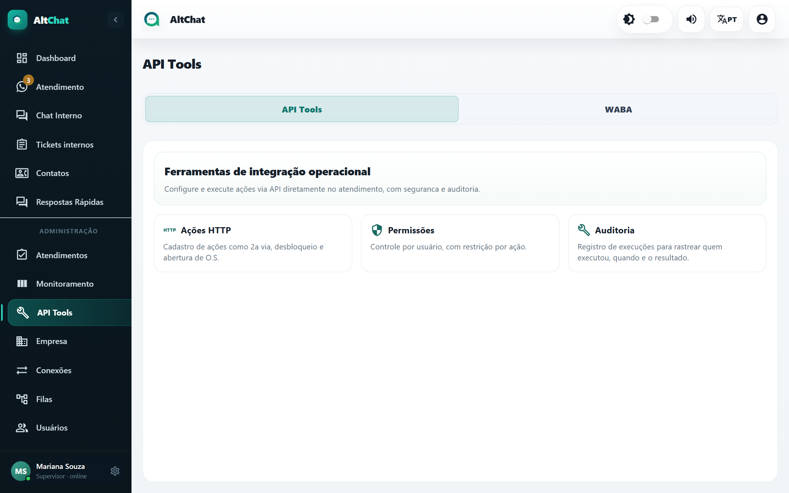

import { Steps, Aside } from '@astrojs/starlight/components';
import Perfil from '../../../components/Perfil.astro';

<Perfil tipo="admin" />

**API Tools** liga o Altchat aos sistemas do provedor. Uma **ação HTTP** é uma chamada a uma API (do ERP, do sistema de cobrança, do ACS) que o atendente dispara com um clique dentro do atendimento, usando dados do contato. O resultado volta para a conversa.

A tela tem duas abas: **API Tools** (as ações) e **WABA** (credenciais e templates da API oficial do WhatsApp, documentadas em [API oficial](/administradores/conexoes/api-oficial-waba/)).

## Exemplos de ações

- **2ª via de boleto**: consulta o ERP pelo CPF/CNPJ do contato e devolve o link do boleto para o atendente enviar.
- **Desbloqueio de confiança**: libera o acesso do cliente por 48 horas.
- **Abrir ordem de serviço**: cria a O.S. no ERP com o protocolo do atendimento.
- **Consultar sinal da ONU**: busca no sistema de monitoramento e mostra os valores.

## Cadastrar uma ação

<Steps>
1. Na aba **API Tools**, clique em adicionar ação.
2. Preencha:

   | Campo | O que é |
   |---|---|
   | **Nome da ação** | Como aparece para o atendente. |
   | **Método** e **Endpoint** | GET, POST etc. e a URL da API do seu sistema. |
   | **Timeout (ms)** | Quanto esperar pela resposta. |
   | **Headers JSON** | Cabeçalhos, por exemplo a autenticação. |
   | **Body template** | Corpo da requisição com variáveis do atendimento. |
   | **Variáveis mapeadas da resposta** | Quais campos do JSON de resposta viram variáveis (nome, origem, caminho JSON, valor padrão). |
   | **Template de resultado** | Texto mostrado ao atendente (e opcionalmente enviado ao cliente) com as variáveis da resposta. |
   | **Requer CPF/CNPJ válido para executar** | Bloqueia a execução se o contato não tem documento cadastrado. |
   | **Usuários autorizados** | Quem pode executar. |
   | **Ação ativa** | Desligue para esconder sem apagar. |

3. Teste com um contato real antes de liberar para a equipe.
</Steps>

Variáveis disponíveis no corpo e nos templates incluem os dados do contato (nome, número, CPF/CNPJ, campos personalizados), do atendimento (protocolo, fila, atendente) e as variáveis mapeadas da resposta.

## Permissões

Cada ação tem a própria lista de **usuários autorizados**. Um atendente sem permissão não vê a ação no atendimento. Use isso para restringir ações sensíveis (desbloqueio, cancelamento) a supervisores.

## Execução e auditoria

O atendente executa a ação pelo menu do atendimento. A tela API Tools guarda o **histórico de execuções**: quem executou, quando, para qual contato e atendimento, o que foi enviado e o que a API respondeu. Filtre por data, ação, usuário, ticket ou contato para investigar.

<Aside type="tip" title="Antes de criar ações">
Confirme com quem mantém o ERP que a API aceita chamadas do endereço do Altchat e qual a forma de autenticação. Para o sistema Altarede, a integração pronta está documentada em [Enviar mensagens pela API](/integracoes/enviar-mensagens-api/#exemplo-erp-do-provedor).
</Aside>
