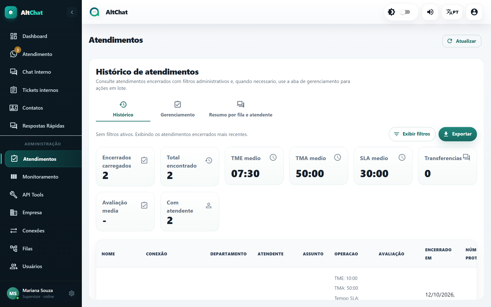
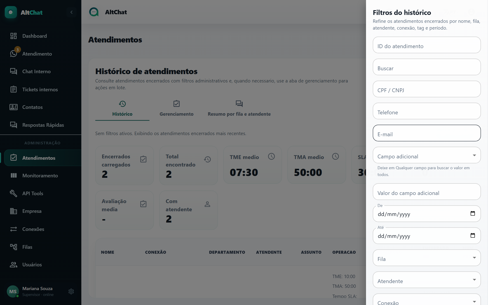
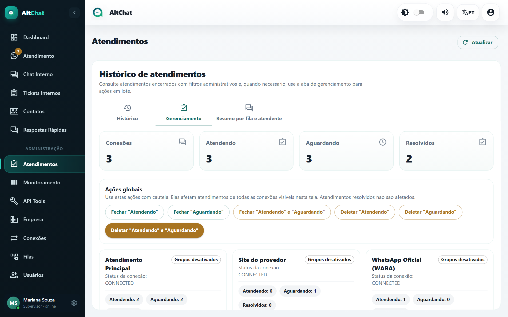
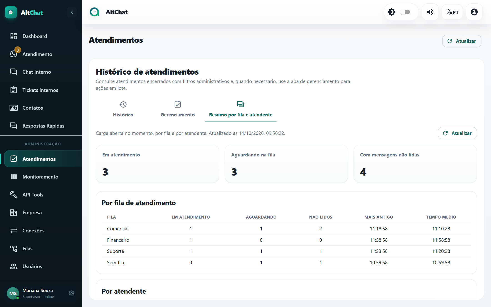

import { Steps, Aside } from '@astrojs/starlight/components';
import Perfil from '../../../components/Perfil.astro';

<Perfil tipo="admin" />

A tela **Atendimentos** tem três abas: **Histórico**, **Gerenciamento** e **Resumo por fila e atendente**.

## Histórico

Lista os atendimentos **encerrados**, do mais recente para o mais antigo, com os indicadores do conjunto filtrado no topo: encerrados carregados, total encontrado, **TME**, **TMA** e **SLA** médios, transferências, avaliação média e quantos tiveram atendente.

Cada linha traz contato e número, conexão, fila, atendente, assunto, os tempos daquele atendimento (TME, TMA, SLA, tempo total, transferências), a avaliação, quando encerrou e o protocolo. Clique no protocolo (**#000007**) para abrir a conversa.

### Filtrar e exportar

<Steps>
1. Clique em **Exibir filtros**.

   

2. Combine período, fila, atendente, conexão, assunto, tag, avaliação ou protocolo. Os indicadores do topo passam a refletir só o que foi filtrado.
3. **Exportar** gera a planilha com as linhas filtradas.
</Steps>

Usos frequentes: relatório mensal por atendente, auditoria de um cliente específico (filtre pelo número), conferência de quantos atendimentos receberam nota.

## Gerenciamento

Mostra, por conexão, quantos atendimentos estão **Atendendo**, **Aguardando** e **Resolvidos**, e oferece ações em lote:

| Ação | Efeito |
|---|---|
| **Fechar "Atendendo"** / **"Aguardando"** / os dois | Resolve todas as conversas naquele estado. Elas continuam no histórico e podem ser reabertas. |
| **Deletar "Atendendo"** / **"Aguardando"** / os dois | Apaga as conversas e suas mensagens. **Não tem volta.** |

As **Ações globais** no topo aplicam a todas as conexões de uma vez. Resolvidos nunca são afetados.

<Aside type="danger" title="Quando usar">
Fechar em lote serve para limpar uma fila represada (por exemplo, depois de um feriado prolongado ou de um disparo em massa). Deletar em lote só faz sentido em ambiente de teste ou para remover lixo de um número que recebeu spam. Em produção, prefira **Fechar**. Cada ação em lote fica registrada na [Auditoria](/administradores/auditoria/).
</Aside>

## Resumo por fila e atendente

Fotografia da carga **aberta agora**, em tabelas:

- **Por fila de atendimento**: em atendimento, aguardando, não lidos, o atendimento mais antigo e o tempo médio de espera. A linha *Sem fila* mostra conversas que ainda não foram roteadas.
- **Por atendente**: situação (online/offline), quantos em atendimento, não lidos, o mais antigo e o tempo médio. Só considera chamados já atribuídos; o que está aguardando aparece apenas no bloco por fila.

Para a visão conversa a conversa, use o [Monitoramento](/administradores/monitoramento/).
