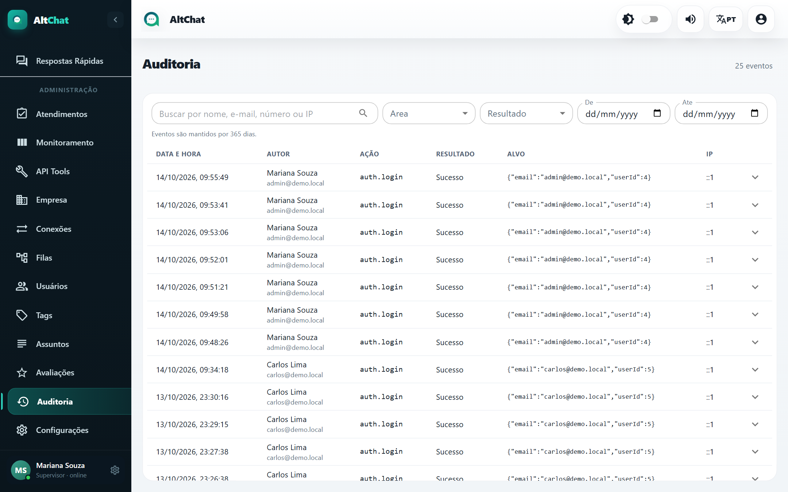

import { Steps, Aside } from '@astrojs/starlight/components';
import Perfil from '../../../components/Perfil.astro';

<Perfil tipo="admin" />

A **Auditoria** registra as ações relevantes feitas no sistema, por usuários e por integrações. Os eventos ficam guardados por **365 dias**.

## O que é registrado

| Área | Exemplos de ação |
|---|---|
| Autenticação | Login, logout, falha de login, desconexão forçada de usuário. |
| Atendimento | Aceite, transferência (com origem e destino), resolução, reabertura, exclusão, mudança de conexão. |
| Mensagens | Edição e exclusão de mensagens. |
| Cadastros | Criação, edição e exclusão de usuários, filas, tags, assuntos, contatos, conexões. |
| Configurações | Alterações nas telas Empresa e Configurações. |
| Ações em lote | Fechar ou deletar em massa pela aba Gerenciamento. |
| API Tools | Execução de ações HTTP, com quem executou e o resultado. |
| Chat interno | Exclusão de conversas e grupos. |

Cada linha mostra **data e hora**, **autor** (nome e e-mail), **ação** (um código como `auth.login` ou `ticket.transfer`), **resultado** (sucesso ou falha), **alvo** (os dados envolvidos, em formato técnico) e o **IP** de origem. O botão no fim da linha abre o detalhe completo.

## Investigar um caso

<Steps>
1. Digite nome, e-mail, número do cliente ou IP na busca.
2. Restrinja por **Área** e **Resultado** e pelo período **De / Até**.
3. Abra o detalhe da linha para ver o conteúdo do evento (por exemplo, a fila de origem e a de destino de uma transferência).
</Steps>

Perguntas que a auditoria responde:

- "Quem transferiu o chamado do cliente X para a fila errada?" Busque pelo número do cliente, área *Atendimento*.
- "Alguém apagou mensagens?" Área *Mensagens*, resultado *Sucesso*.
- "Quem mudou a mensagem fora do horário?" Área *Configurações*.
- "Houve tentativas de login de um IP estranho?" Busque pelo IP, área *Autenticação*, resultado *Falha*.

<Aside type="note">
A auditoria não registra o conteúdo das conversas com clientes, só as ações sobre elas. Para ler a conversa, abra o atendimento pelo protocolo na tela [Atendimentos](/administradores/atendimentos/).
</Aside>
