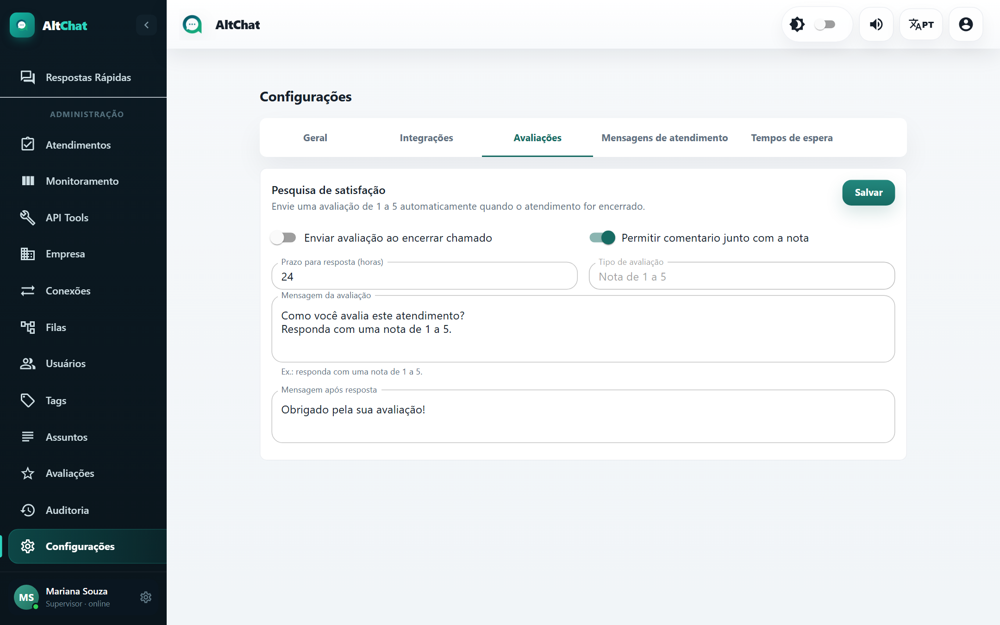
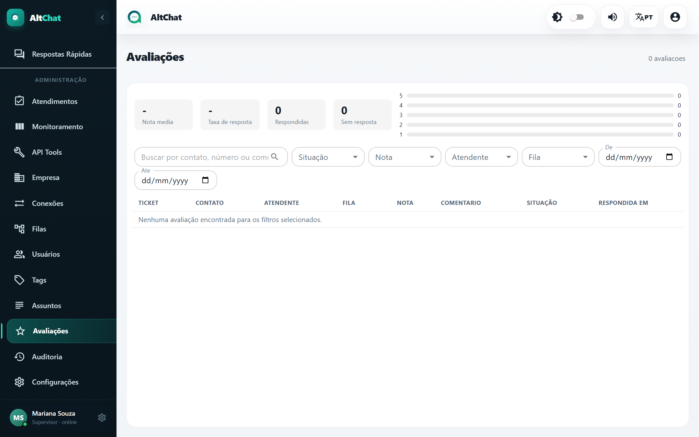

import { Steps, Aside } from '@astrojs/starlight/components';
import Perfil from '../../../components/Perfil.astro';

<Perfil tipo="admin" />

Quando a pesquisa de satisfação está ligada, o cliente recebe uma pergunta de nota (1 a 5) assim que o atendimento é resolvido. A resposta dele fica no atendimento e na tela **Avaliações**.

## Ativar

<Steps>
1. Abra **Configurações → Avaliações**.

   

2. Marque **Enviar avaliação ao encerrar chamado**.
3. Decida se o cliente pode escrever um comentário junto com a nota (**Permitir comentário junto com a nota**).
4. Defina o **Prazo para resposta (horas)**: depois disso a resposta do cliente não conta mais como avaliação e vira uma mensagem comum, que abre um atendimento novo. Entre 1 e 720 horas; 24 é um bom padrão.
5. Ajuste a **Mensagem da avaliação** (o que o cliente recebe ao encerrar) e a **Mensagem após resposta** (o agradecimento).
6. **Salvar**.
</Steps>

<Aside type="caution" title="Como o cliente responde">
O cliente responde com um número de 1 a 5 na própria conversa. Se ele mandar outra coisa dentro do prazo, o Altchat entende como nova mensagem e abre um atendimento. Por isso a mensagem precisa ser clara: "Responda com uma nota de 1 a 5".
</Aside>

## Ler os resultados

No topo: **nota média**, **taxa de resposta** (quantos clientes responderam entre os que receberam a pesquisa), respondidas, sem resposta e a distribuição por nota. Abaixo, a lista com ticket, contato, atendente, fila, nota, comentário, situação (respondida, pendente, expirada) e a data da resposta.

Filtre por **Situação**, **Nota**, **Atendente**, **Fila** e período. A busca aceita nome, número ou trecho do comentário. Clique no ticket para abrir a conversa.

A **avaliação média** também aparece na tela [Atendimentos](/administradores/atendimentos/#historico) e no histórico de cada atendimento.

## Boas práticas

- Uma taxa de resposta abaixo de 20% costuma indicar prazo curto ou mensagem confusa.
- Notas 1 e 2 merecem leitura do comentário e da conversa no mesmo dia.
- Não ligue a avaliação em conexões usadas só por chatbots: o cliente recebe a pergunta sem ter falado com ninguém.
