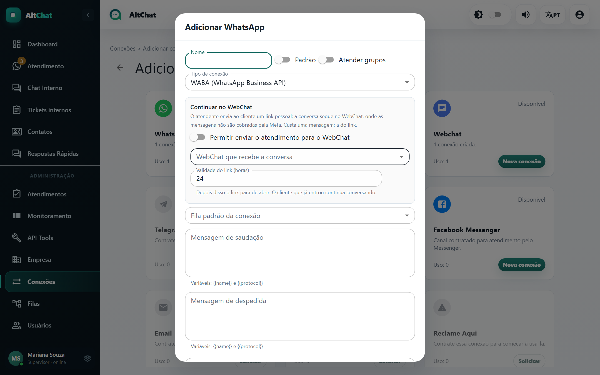
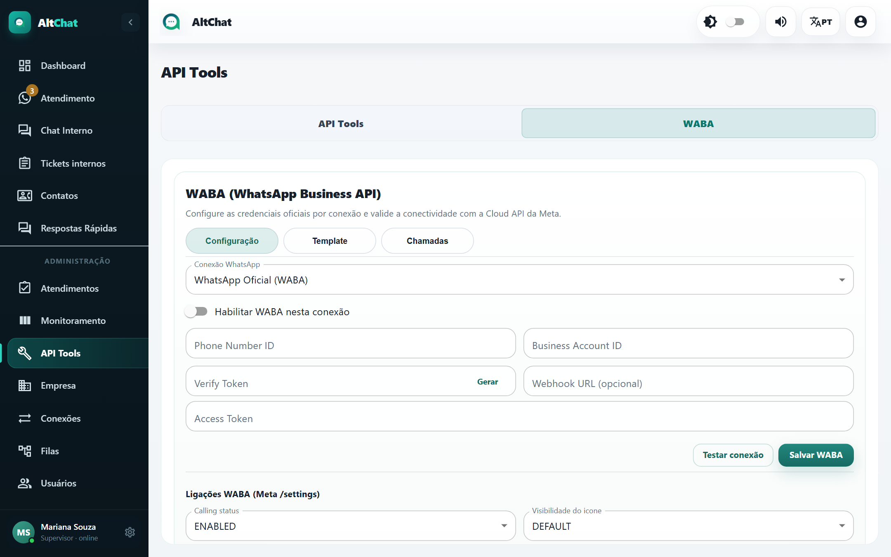

import { Steps, Aside } from '@astrojs/starlight/components';
import Perfil from '../../../../components/Perfil.astro';

<Perfil tipo="admin" />

A conexão **WABA** (WhatsApp Business API) usa a Cloud API da Meta. É a forma oficial: não depende de celular, aguenta volume alto, não corre risco de banimento por uso normal, e permite chamadas de voz. Em troca, a Meta cobra por conversa e impõe regras: **templates** aprovados para iniciar conversa e a **janela de 24 horas** para responder livremente.

## Antes de começar

Você precisa de uma conta no **Meta Business** com um número verificado na Cloud API e destes dados, obtidos no painel da Meta (WhatsApp → Configuração da API):

- **Phone Number ID**
- **Business Account ID** (WABA ID)
- **Access Token** permanente (token de usuário do sistema com permissão `whatsapp_business_messaging`)

Se a conta foi contratada pela Gupshup, siga o guia [WABA via Gupshup](/administradores/conexoes/gupshup/).

## Passo 1: criar a conexão

<Steps>
1. Em **Conexões → Adicionar**, no cartão **WhatsApp Business API**, clique em **Nova conexão**.

   

2. **Tipo de conexão**: *WABA (WhatsApp Business API)*.
3. Preencha nome, filas, fila padrão, saudação e despedida. Veja também o bloco **Continuar no WebChat**, explicado abaixo.
4. **Adicionar**. O cartão aparece com o botão **Configurar**: faltam as credenciais.
</Steps>

## Passo 2: credenciais e webhook (API Tools → WABA)

<Steps>
1. Abra **API Tools** e clique na aba **WABA**.

   

2. Em **Conexão WhatsApp**, escolha a conexão criada e ligue **Habilitar WABA nesta conexão**.
3. Preencha **Phone Number ID**, **Business Account ID** e **Access Token**.
4. Em **Verify Token**, clique em **Gerar**. Copie o valor: ele vai para o painel da Meta.
5. Clique em **Testar conexão**. O Altchat consulta a Meta e confirma o número. Depois, **Salvar WABA**.
6. No painel da Meta, em **WhatsApp → Configuração → Webhook**, informe a **URL de callback** mostrada pelo Altchat e o **Verify Token** gerado, e assine o campo **messages**. Sem o webhook, você envia mas não recebe.
7. Volte em **Conexões**: o cartão deve estar **Conectado**.
</Steps>

<Aside type="caution" title="Token temporário expira em 24 horas">
O token que a Meta mostra na tela de testes dura um dia. Para produção, crie um **usuário do sistema** no Meta Business e gere um token permanente. Quando o token expira, o cartão volta a *Configurar* e as mensagens param.
</Aside>

## Templates

Fora da janela de 24 horas, ou para iniciar uma conversa, a Meta só aceita **templates** aprovados. Na aba **WABA → Template** você cria e envia para aprovação: nome interno, categoria (utilidade, marketing, autenticação), idioma, cabeçalho, corpo com variáveis, rodapé e botões (URL, telefone ou resposta rápida). A aprovação costuma levar de minutos a um dia.

O atendente usa o template na conversa quando o Altchat avisa que a janela fechou. Templates de **marketing** têm custo maior; use **utilidade** para avisos de fatura, visita técnica e protocolo.

## A janela de 24 horas

| Situação | O que pode ser enviado |
|---|---|
| Cliente escreveu há menos de 24 h | Qualquer mensagem, texto livre, mídia. |
| Cliente escreveu há mais de 24 h, ou nunca | Só template aprovado. A resposta dele reabre a janela. |

A Meta cobra por **conversa** (janela de 24 h), com preço diferente conforme quem iniciou e a categoria. Conversas iniciadas pelo cliente e respondidas dentro da janela são as mais baratas.

## Continuar no WebChat (link de continuação)

Para não pagar por conversas longas de suporte, a conexão WABA pode mandar ao cliente um **link pessoal** que continua a conversa no **WebChat** do Altchat, onde a Meta não cobra. Custa uma mensagem: a do link.

Na janela da conexão, bloco **Continuar no WebChat**:

- **Permitir enviar o atendimento para o WebChat**: liga o botão para o atendente.
- **WebChat que recebe a conversa**: qual conexão de WebChat atende do outro lado (crie uma só para isso, com fila padrão).
- **Validade do link (horas)**: depois disso o link para de abrir; quem já entrou continua.

Requisitos: o endereço público do Altchat precisa usar **https**, e a conexão de destino precisa ser um WebChat que não seja "só app".

## Chamadas de voz

Com **Ligações WABA** habilitadas na aba WABA (**Calling status**, visibilidade do ícone e **Callback permission**), o atendente ganha o botão *Ligar* no atendimento. A Meta exige que o cliente **permita** receber chamadas: o Altchat envia o pedido oficial e mostra o estado da permissão (válida por 7 dias, no máximo 2 pedidos por semana). Para voz em tempo real a empresa precisa de telefonia SIP configurada; veja [Ramais e chamadas](/administradores/ramais-e-chamadas/).

## Limites e cuidados

| Tema | Como é |
|---|---|
| Custo | Por conversa, cobrado pela Meta. |
| Iniciar conversa | Só com template. |
| Mídia | Fotos, vídeos, áudios e documentos comuns. **.zip e .rar são recusados.** |
| Grupos | Não suportado. |
| Foto de perfil do contato | A Meta não fornece. |
| Estabilidade | Alta. Falhas quase sempre são token expirado ou webhook desassinado. |

## Problemas comuns

- **Envio recusado com erro 10 ou 2593180.** O número não tem permissão de envio na Meta (conta sem método de pagamento, número não verificado ou conta restrita). Confira no Meta Business.
- **Recebo mas não envio.** Token expirado ou sem permissão. Gere um token permanente.
- **Envio mas não recebo.** Webhook não configurado ou sem o campo *messages* assinado.
- **"Esta conexão não consegue enviar mensagens".** O atendimento está numa conexão arquivada ou sem credenciais. Transfira para a conexão certa.
