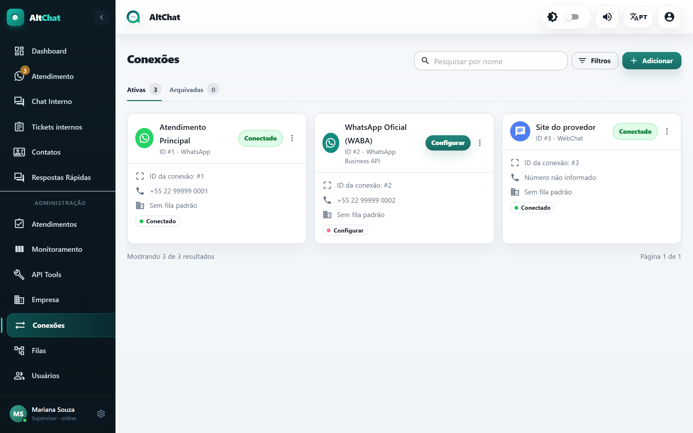
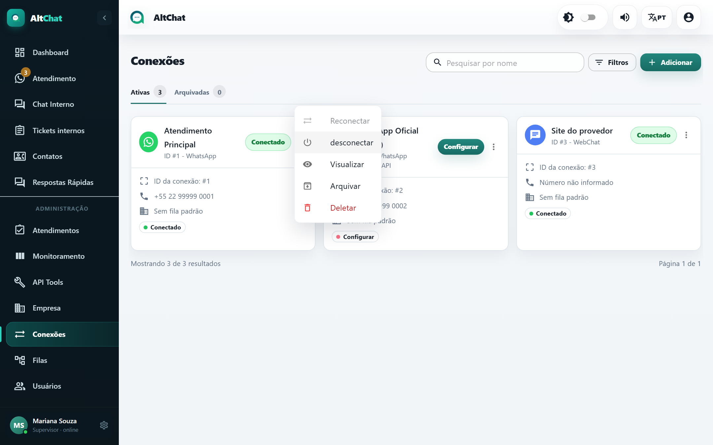
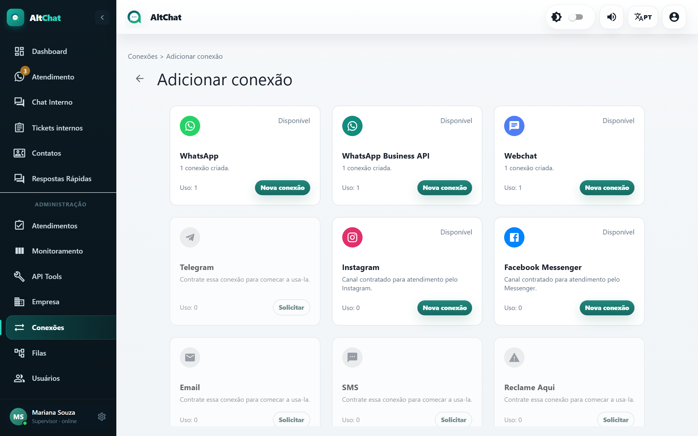

import { Steps, Aside, CardGrid, LinkCard } from '@astrojs/starlight/components';
import Perfil from '../../../../components/Perfil.astro';

<Perfil tipo="admin" />

Uma **conexão** é um canal concreto ligado à empresa: um número de WhatsApp, o WebChat do site, uma conta de Instagram. Toda conversa pertence a uma conexão, e é pela conexão que o Altchat sabe por onde responder.

## Os cartões

Cada cartão mostra o **nome**, o **ID** e o tipo, o número conectado, a **fila padrão** e o estado. As abas **Ativas** e **Arquivadas** separam as conexões em uso das desativadas. A busca e os **Filtros** ajudam quando há muitas.

| Estado | Significado | O que fazer |
|---|---|---|
| **Conectado** | Funcionando. | Nada. |
| **Configurar** | Conexão criada, mas faltam credenciais (comum na API oficial). | Clique e complete os dados. |
| **QR Code** / **Pareando** | Conexão por QR Code esperando leitura. | Clique em *QR Code* e leia com o celular. |
| **Desconectado** / **Tempo esgotado** | A sessão caiu. | Menu ⋮ → *Reconectar*; se não voltar, leia o QR de novo. |
| **Abrindo** | Iniciando. | Aguarde alguns segundos. |

Quando alguma conexão não está conectada, o item **Conexões** do menu lateral mostra um **!** e a tela de atendimento exibe um aviso para a equipe.

## Menu de ações (⋮)

| Ação | Efeito |
|---|---|
| **Reconectar** | Tenta restabelecer a sessão sem novo QR. Fica desabilitado quando já está conectado. |
| **Desconectar** | Encerra a sessão. O número para de receber até reconectar. |
| **Visualizar** / editar | Abre a janela de configuração. |
| **Arquivar** | Tira a conexão da operação sem apagar o histórico. Os atendimentos dela ficam acessíveis; novas mensagens não entram. Aparece na aba *Arquivadas*, de onde pode ser restaurada. |
| **Deletar** | Apaga a conexão. Os atendimentos vinculados ficam sem conexão válida. Prefira arquivar. |

## Adicionar uma conexão: o catálogo

**Adicionar** abre o catálogo de canais. O que a empresa pode criar depende do **pacote de canais** contratado:

- **Nova conexão**: canal contratado e com vaga. Abre a janela de cadastro.
- **Solicitar**: canal não contratado ou limite atingido. Abre uma conversa com o suporte do Altchat para contratar.
- **Conector em preparação**: canal ainda não disponível (Telegram, e-mail, SMS, Reclame Aqui).

Guia de cada tipo:

<CardGrid>
	<LinkCard title="WhatsApp por QR Code" description="Um número comum ou Business, pareado como no WhatsApp Web." href="/administradores/conexoes/whatsapp-qr-code/" />
	<LinkCard title="WhatsApp API oficial (WABA)" description="Cloud API da Meta: estável, com templates e janela de 24 horas." href="/administradores/conexoes/api-oficial-waba/" />
	<LinkCard title="WABA via Gupshup" description="API oficial contratada pela Gupshup." href="/administradores/conexoes/gupshup/" />
	<LinkCard title="WebChat" description="Widget no site do provedor e chat dentro do app do assinante." href="/administradores/conexoes/webchat/" />
	<LinkCard title="Instagram Direct e Messenger" description="Contas da Meta ligadas por token e webhook." href="/administradores/conexoes/instagram-e-messenger/" />
</CardGrid>

## Campos comuns a todos os tipos

A janela de cadastro muda conforme o tipo, mas estes campos existem sempre:

| Campo | Para quê |
|---|---|
| **Nome** | Como a conexão aparece para a equipe. Use algo que identifique o uso: "Suporte 0800", "Comercial Zap". |
| **Padrão** | A conexão usada quando um atendente clica em *Novo* e não tem conexão padrão própria. Só uma pode ser padrão. |
| **Atender grupos** | Se desligado, mensagens de grupos do WhatsApp são ignoradas. Ligue só se a empresa atende por grupos. |
| **Fila padrão da conexão** | Conversa nova cai direto nessa fila, sem menu de opções. Veja [Filas](/administradores/filas/#fila-padrão). |
| **Mensagem de saudação** | Enviada na primeira mensagem do cliente. Sem fila padrão, é aqui que vai o menu "1 - Suporte, 2 - Financeiro...". Aceita `{{name}}` e `{{protocol}}`. |
| **Mensagem de despedida** | Enviada ao resolver o atendimento. |
| **Filas** | Quais filas esta conexão oferece. |
| **Integração n8n** e **Integração Typebot** | Chatbots que respondem antes do atendente. Veja [Chatbots](/integracoes/chatbots/). |

<Aside type="tip" title="Saudação com menu de filas">
Escreva as opções na mesma ordem em que as filas aparecem no campo *Filas* e numere a partir de 1. O cliente responde "2" e cai na segunda fila da lista. Uma saudação curta, com no máximo cinco opções, reduz respostas erradas.
</Aside>

## Quantas conexões ter

- Um número por setor só quando os setores têm equipes e horários realmente separados. Na maioria dos provedores, **um número com filas** resolve e evita o cliente mandar mensagem no número errado.
- Nunca deixe duas conexões ativas para o **mesmo número** (por exemplo, uma por QR e outra pela API oficial). A transferência pode levar o atendimento para a conexão que não consegue responder.
