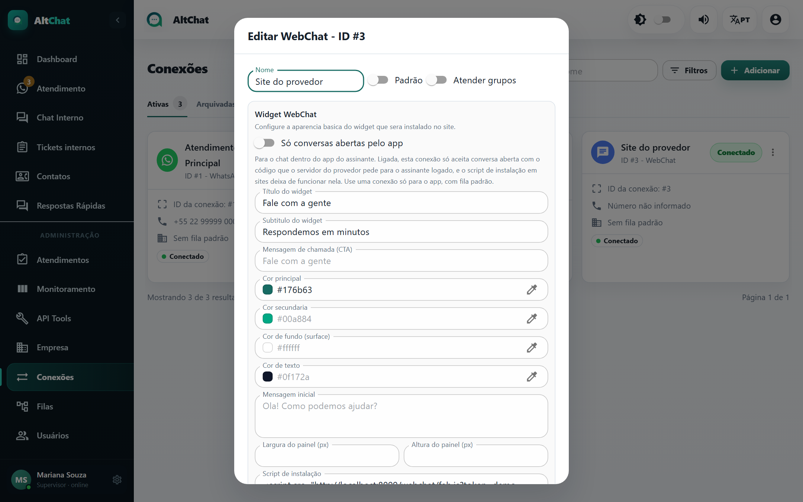

import { Steps, Aside } from '@astrojs/starlight/components';
import Perfil from '../../../../components/Perfil.astro';

<Perfil tipo="admin" />

O **WebChat** é o balão de conversa no site do provedor e o chat dentro do **app do assinante**. As conversas chegam à mesma tela de atendimento, com o ícone de chat no lugar do ícone do WhatsApp. Não tem custo por mensagem.

## Criar a conexão

<Steps>
1. Em **Conexões → Adicionar**, no cartão **Webchat**, clique em **Nova conexão**.
2. **Tipo de conexão**: *WebChat*.
3. No bloco **Widget WebChat**, personalize:

   

   | Campo | O que faz |
   |---|---|
   | **Título** e **Subtítulo do widget** | Cabeçalho do balão ("Fale com a gente", "Respondemos em minutos"). |
   | **Mensagem de chamada (CTA)** | Texto do botão flutuante que convida a abrir o chat. |
   | **Cor principal**, **secundária**, **de fundo**, **de texto** | Identidade visual, para combinar com o site. |
   | **Mensagem inicial** | Primeira frase que o visitante vê ao abrir. |
   | **Largura** e **Altura do painel** | Tamanho do chat aberto, em pixels. |

4. Defina **Fila padrão**: no WebChat o visitante não escolhe fila por número, então a fila padrão é praticamente obrigatória.
5. **Adicionar**. Abra a conexão de novo (⋮ → *Visualizar*) para copiar o **Script de instalação**.
</Steps>

## Instalar no site

Cole o script antes de `</body>` em todas as páginas do site:

```html
<script src="https://app.altchat.com.br/webchat/fab.js?token=SEU-TOKEN"
        data-webchat-channel-id="SEU-TOKEN"
        data-api-url="https://app.altchat.com.br" async></script>
```

O token identifica a conexão e é público por natureza: qualquer visitante do site o vê. Ele só permite abrir conversa, nunca ler conversas de outros visitantes. Mudanças feitas na janela da conexão (cores, textos) chegam ao site na hora, sem trocar o script.

<Aside type="tip" title="Teste antes de publicar">
Abra o site numa aba anônima, inicie uma conversa e veja-a aparecer em *Aguardando*. Responda pelo Altchat e confira se chega no balão. Lembre que o WebChat só troca **texto e links**: fotos, áudios e arquivos não são enviados.
</Aside>

## Conexão exclusiva para o app do assinante

Quando o provedor tem um app com área do cliente, o chat de dentro do app usa uma conexão WebChat própria com **Só conversas abertas pelo app** ligado. Nessa conexão:

- Só entra conversa aberta com o **código** que o servidor do provedor gera para o assinante logado. O script de site deixa de funcionar nela.
- O contato é criado pelo **código do cliente** do provedor, nunca pelo celular, então o atendente já vê quem é.
- O atendente não consegue alterar o número desse contato.

Crie-a separada da conexão do site, com fila padrão, e mantenha a do site aberta ao público. O que o programador do app precisa está em [App do provedor](/integracoes/app-do-provedor/).

## Recebendo conversas da API oficial

Uma conexão WABA pode **continuar a conversa no WebChat** para evitar o custo da Meta. Para isso ela aponta para uma conexão de WebChat como destino. Reserve uma conexão WebChat para esse papel (ela não pode ser "só app") e dê a ela a mesma fila da conexão WABA, para o mesmo atendente continuar. Veja [API oficial → Continuar no WebChat](/administradores/conexoes/api-oficial-waba/#continuar-no-webchat-link-de-continuação).

## Problemas comuns

- **O balão não aparece no site.** O script não está na página, ou foi colocado com o token errado. Confira no código-fonte da página.
- **Visitante escreve e nada chega.** Conexão arquivada, ou o endereço em `data-api-url` não é o do Altchat em produção.
- **"O WebChat ainda não envia arquivos".** Comportamento esperado; mande um link.
