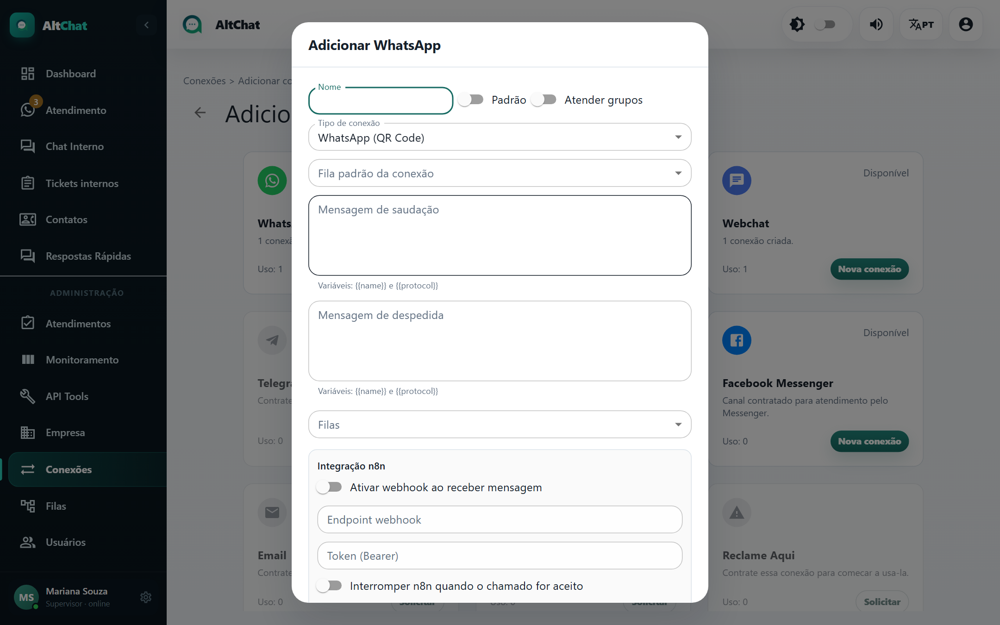

import { Steps, Aside } from '@astrojs/starlight/components';
import Perfil from '../../../../components/Perfil.astro';

<Perfil tipo="admin" />

A conexão por **QR Code** usa um número de WhatsApp comum (ou WhatsApp Business do celular) pareado ao Altchat, do mesmo jeito que o WhatsApp Web. Não precisa de aprovação da Meta nem tem custo por mensagem, mas depende de um celular ligado e segue as regras de uso do WhatsApp.

## Antes de começar

- Um celular com o número instalado, com internet, que vai ficar ligado.
- O número pode continuar sendo usado no celular; o Altchat é um "aparelho conectado" a mais.
- Se o número já estava pareado a outro sistema, desconecte lá primeiro (WhatsApp → Aparelhos conectados).

## Criar a conexão

<Steps>
1. Em **Conexões**, clique em **Adicionar** e, no cartão **WhatsApp**, em **Nova conexão**.

   

2. **Tipo de conexão**: *WhatsApp (QR Code)*.
3. Preencha nome, filas, fila padrão, saudação e despedida (veja os [campos comuns](/administradores/conexoes/#campos-comuns-a-todos-os-tipos)).
4. **Puxar histórico dos últimos 10 dias**: marque se quer que as conversas recentes do celular entrem no Altchat na primeira sincronização. Elas chegam como atendimentos já com mensagens. Desmarcado, só mensagens novas entram.
5. **Adicionar**. O cartão da conexão aparece no estado *QR Code*.
6. Clique em **QR Code** no cartão. No celular, abra o WhatsApp → **Aparelhos conectados** → **Conectar um aparelho** e aponte a câmera para a tela.
7. Em alguns segundos o cartão muda para **Conectado** e mostra o número.
</Steps>

<Aside type="caution" title="O QR expira">
O código muda a cada poucos segundos e a janela fecha sozinha depois de um tempo. Se expirar, feche e clique em *QR Code* de novo.
</Aside>

## Manter a sessão estável

- **Celular ligado e com internet.** A sessão sobrevive a quedas curtas, mas um celular desligado por muitas horas derruba a conexão.
- **Não faça logout no celular** do Altchat em *Aparelhos conectados*.
- Se o cartão ficar em **Desconectado**, use ⋮ → **Reconectar**. Se não voltar, clique em *QR Code* e leia novamente.
- O Altchat vigia sessões que travam em silêncio e as recupera sozinho. Quando isso não resolve, o aviso de conexão aparece para toda a equipe na tela de atendimento.
- **Foto de perfil** dos contatos é buscada automaticamente e renovada de tempos em tempos.

## Limites e cuidados

| Tema | Como é |
|---|---|
| Custo | Nenhum por mensagem. |
| Iniciar conversa | Livre: o atendente pode escrever para qualquer número, sem template. |
| Mídia | Tudo o que o WhatsApp aceita, inclusive .zip. |
| Grupos | Suportado, se *Atender grupos* estiver ligado. |
| Estabilidade | Depende do celular e de mudanças do WhatsApp. É o tipo que mais exige atenção do administrador. |
| Risco de bloqueio | O WhatsApp pode restringir números que disparam muitas mensagens para quem não respondeu. Não use conexão por QR para campanhas em massa. |
| Contatos sem número (LID) | Alguns contatos chegam identificados por um código interno em vez do número. O Altchat trata e reconcilia quando o número aparece. |

Para operação crítica ou volume alto, prefira a [API oficial](/administradores/conexoes/api-oficial-waba/).

## Problemas comuns

- **"QR Code" não aparece ou fica em branco.** Aguarde 20 segundos e reabra. Se persistir, ⋮ → *Desconectar* e depois *QR Code*.
- **Conectou e caiu em seguida.** Outro sistema está usando o mesmo número. Desconecte-o em *Aparelhos conectados* do celular.
- **Todas as conexões caíram ao mesmo tempo.** Geralmente é uma mudança do WhatsApp que exige atualização do Altchat. Avise o suporte.
- **Mensagem fica com um tique só.** O celular está sem internet ou a sessão caiu. Confira o estado do cartão.
