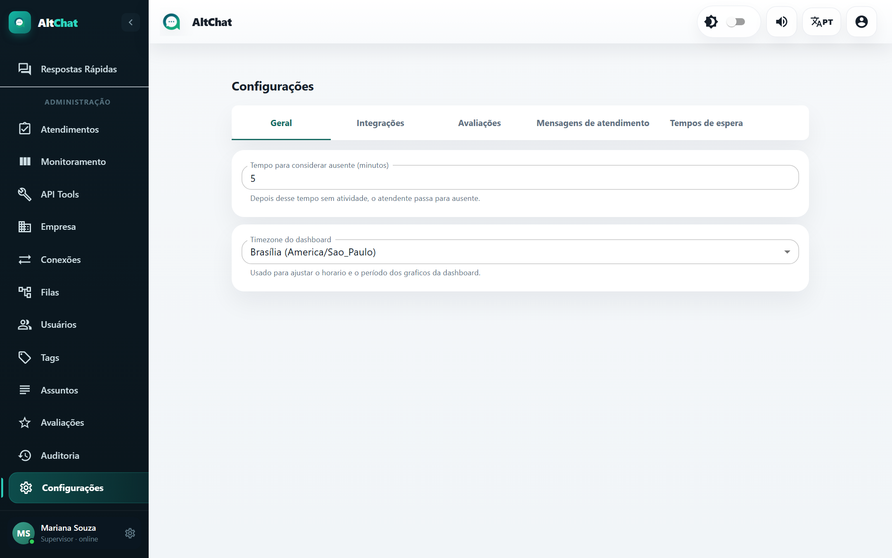
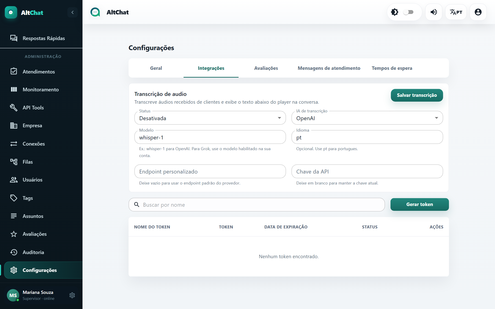

import { Steps, Aside } from '@astrojs/starlight/components';
import Perfil from '../../../../components/Perfil.astro';

<Perfil tipo="admin" />

A tela **Configurações** tem cinco abas: **Geral**, **Integrações**, **Avaliações**, **Mensagens de atendimento** e **Tempos de espera**. Esta página cobre as duas primeiras. As outras têm guias próprios: [Avaliações](/administradores/avaliacoes/), [Mensagens automáticas](/administradores/configuracoes/mensagens-automaticas/) e [Tempos de espera](/administradores/configuracoes/tempos-de-espera/).

## Geral

| Opção | Efeito |
|---|---|
| **Tempo para considerar ausente (minutos)** | Sem atividade por esse tempo, o usuário passa a *ausente*. É o mesmo campo da tela Empresa. |
| **Timezone do dashboard** | Fuso usado para montar os períodos e as faixas de horário do Dashboard. Mantenha igual ao fuso da operação. |

## Integrações

### Transcrição de áudio

Transcreve automaticamente os áudios que os clientes enviam e mostra o texto abaixo do player. O atendente lê em vez de ouvir, e a busca passa a encontrar o conteúdo dos áudios.

<Steps>
1. **Status**: *Ativada*.
2. **IA de transcrição**: *OpenAI* ou *Grok/xAI*. Você precisa de uma conta e de uma chave de API no provedor escolhido; a cobrança é feita por ele, por minuto de áudio.
3. **Modelo**: `whisper-1` para OpenAI; para Grok, o modelo habilitado na sua conta.
4. **Idioma**: `pt`. Melhora a precisão.
5. **Endpoint personalizado**: deixe vazio, a menos que use um proxy ou outro provedor compatível.
6. **Chave da API**: cole a chave. Ela fica guardada criptografada e não é exibida de novo; para trocar, cole a nova.
7. **Salvar transcrição**.
</Steps>

A transcrição leva alguns segundos após o áudio chegar. Áudios muito longos ou com muito ruído podem vir incompletos.

### Tokens de API

Tokens de integração permitem que outros sistemas (o ERP do provedor, o n8n, scripts) enviem mensagens e consultem o Altchat pela API.

<Steps>
1. Clique em **Gerar token**.
2. Dê um **nome** que identifique o uso ("ERP cobrança", "n8n") e escolha o **prazo de expiração** (30, 90 dias...).
3. Copie o token na hora: **ele só é exibido uma vez**.
4. Na lista, você pode renomear, **revogar** (invalida na hora) e ver a data de expiração.
</Steps>

Como usar o token está em [Tokens e webhooks](/integracoes/tokens-e-webhooks/).

<Aside type="caution">
Um token vazado permite enviar mensagens em nome da empresa. Revogue imediatamente se suspeitar, e prefira prazos curtos com renovação a tokens sem expiração.
</Aside>
