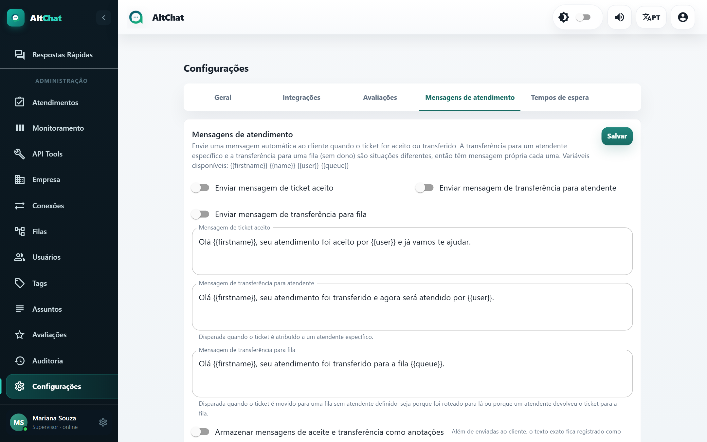

import { Steps, Aside } from '@astrojs/starlight/components';
import Perfil from '../../../../components/Perfil.astro';

<Perfil tipo="admin" />

Em **Configurações → Mensagens de atendimento** você liga avisos automáticos ao cliente nos três momentos em que o responsável pela conversa muda.

## As três mensagens

| Mensagem | Quando sai | Exemplo |
|---|---|---|
| **Ticket aceito** | Um atendente clica em *Aceitar* numa conversa aguardando. | "Olá João, seu atendimento foi aceito por Carlos e já vamos te ajudar." |
| **Transferência para atendente** | A conversa é transferida para uma pessoa específica. | "Olá João, seu atendimento foi transferido e agora será atendido por Juliana." |
| **Transferência para fila** | A conversa vai para uma fila sem atendente definido: transferida só para a fila, ou devolvida pelo botão *Retornar*. | "Olá João, seu atendimento foi transferido para a fila Financeiro." |

Cada uma tem a própria chave de ativação e o próprio texto. Ligue só as que fazem sentido: em operações pequenas, o aviso de aceite pode parecer robótico; em operações com muitas transferências, o aviso de fila evita que o cliente ache que foi abandonado.

## Variáveis

| Variável | Vira |
|---|---|
| `{{firstname}}` | Primeiro nome do contato |
| `{{name}}` | Nome completo do contato |
| `{{user}}` | Nome do atendente que aceitou ou recebeu |
| `{{queue}}` | Nome da fila de destino |

## Registrar como anotação

**Armazenar mensagens de aceite e transferência como anotações** guarda o texto exato enviado como anotação interna no atendimento, visível só para a equipe. Serve como trilha: quem olha a conversa depois vê quando e para quem ela passou.

<Aside type="note" title="Aceite e transferência não se somam">
Quando uma transferência atribui a conversa diretamente a uma pessoa, sai só a mensagem de transferência para atendente, não a de aceite. O cliente nunca recebe duas mensagens pela mesma ação.
</Aside>

## Em conexões da API oficial

Fora da janela de 24 horas, a Meta não aceita texto livre, e a mensagem automática não é entregue. Dentro da janela, sai normalmente. Em conexões por QR Code e no WebChat não há restrição.

## Passo a passo

<Steps>
1. Marque as chaves das mensagens que quer enviar.
2. Edite os textos usando as variáveis acima.
3. Decida sobre **Armazenar como anotações**.
4. **Salvar**. Vale para todas as conexões da empresa a partir da próxima ação.
</Steps>
