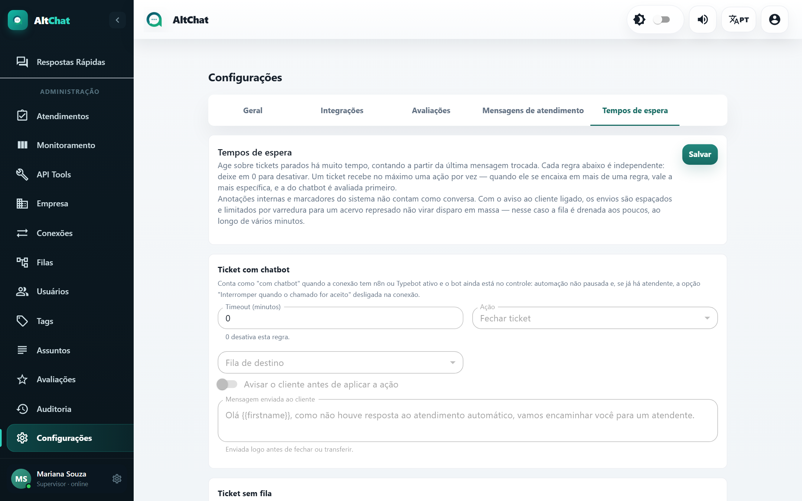

import { Steps, Aside } from '@astrojs/starlight/components';
import Perfil from '../../../../components/Perfil.astro';

<Perfil tipo="admin" />

**Tempos de espera** age sobre conversas paradas há muito tempo, contando a partir da **última mensagem trocada**. Sem isso, atendimentos que o cliente abandonou ficam abertos para sempre e sujam a fila e os relatórios.

## As quatro regras

Cada regra é independente. **0 minutos desativa** a regra. Uma conversa recebe no máximo uma ação por vez; quando se encaixa em mais de uma, vale a mais específica, e a do chatbot é avaliada primeiro.

| Regra | Situação da conversa | Ações possíveis | Quando usar |
|---|---|---|---|
| **Ticket com chatbot** | A conexão tem n8n ou Typebot ativo e o bot ainda está no controle. | Fechar ou transferir para uma fila. | Cliente que não responde ao bot. Transferir para a fila humana é o uso comum. |
| **Ticket sem fila** | Aguardando e sem fila: o cliente não escolheu a opção do menu. | Fechar ou transferir. | Evitar conversas invisíveis para a equipe. Transfira para a fila principal. |
| **Ticket aguardando em fila** | Roteado, ninguém aceitou. A demora foi da empresa. | Fechar ou transferir. | Encerrar com uma mensagem que reconheça a demora e peça para chamar de novo. |
| **Ticket em atendimento** | Aceito, e a última mensagem foi do atendente: quem parou de responder foi o cliente. | Fechar ou retornar para a fila. | Encerrar conversas resolvidas que o cliente não confirmou. |

A regra *em atendimento* **nunca** fecha uma conversa em que o atendente está devendo resposta.

## Avisar o cliente

Cada regra tem **Avisar o cliente antes de aplicar a ação** com uma **Mensagem enviada ao cliente** (aceita `{{firstname}}`). A mensagem sai logo antes de fechar ou transferir. Os textos padrão já são adequados; ajuste o tom à sua marca.

<Aside type="note" title="Sem disparo em massa">
Quando há um acervo represado (por exemplo, ao ligar a regra pela primeira vez com centenas de conversas antigas), os avisos são enviados aos poucos, ao longo de vários minutos, para não parecer disparo em massa para o WhatsApp.
</Aside>

## O que não conta como conversa

Anotações internas e marcadores do sistema (aceite, transferência) não zeram o relógio. Só mensagens reais, do cliente ou do atendente.

## Sugestão de partida

| Regra | Minutos | Ação |
|---|---|---|
| Com chatbot | 30 | Transferir para a fila de Suporte, com aviso |
| Sem fila | 60 | Transferir para a fila principal, com aviso |
| Aguardando em fila | 0 (desligado) ou 720 | Fechar, com aviso de desculpas |
| Em atendimento | 1440 (24 h) | Fechar, com aviso |

<Steps>
1. Preencha **Timeout (minutos)**, **Ação** e, quando for transferir, a **Fila de destino**.
2. Ligue o aviso e revise a mensagem.
3. **Salvar**. A varredura roda em segundo plano a cada poucos minutos.
</Steps>

Cada fechamento ou transferência automática fica registrado na conversa e na [Auditoria](/administradores/auditoria/).
