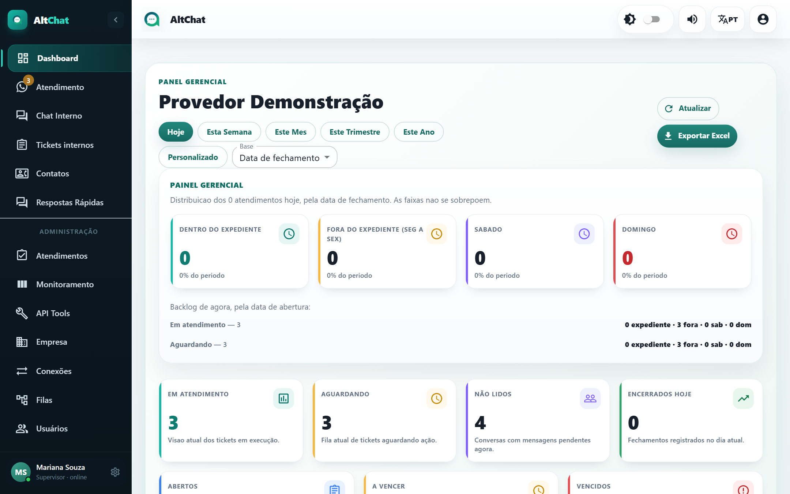
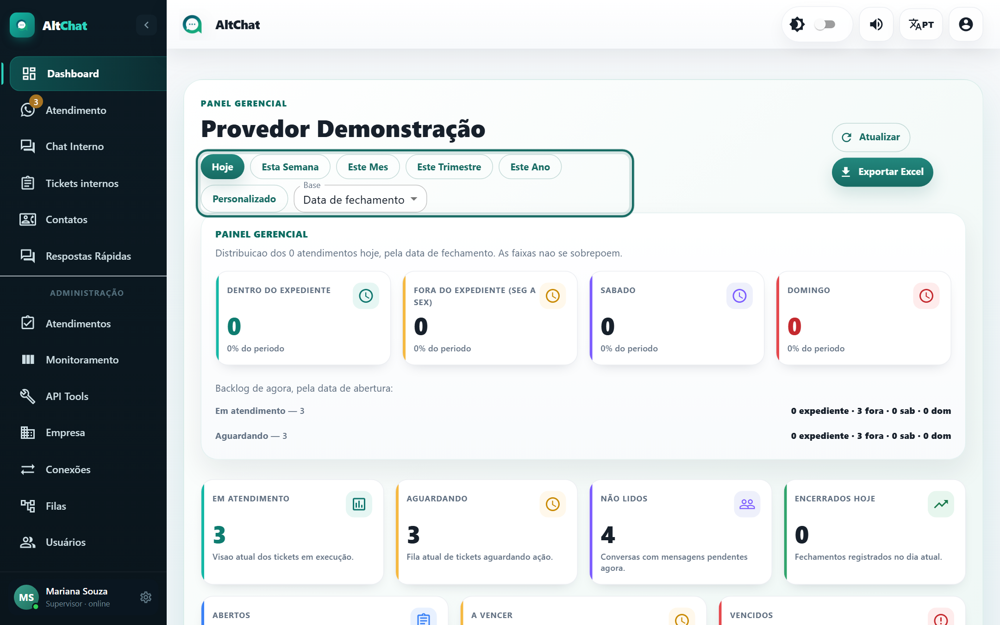

import { Aside } from '@astrojs/starlight/components';
import Perfil from '../../../components/Perfil.astro';

<Perfil tipo="atendente" /> <Perfil tipo="admin" />

O Dashboard é a primeira tela depois do login. O atendente vê os números das suas filas; o administrador vê a empresa inteira.

## Escolher o período e a base

- **Período**: Hoje, Esta Semana, Este Mês, Este Trimestre, Este Ano ou **Personalizado** (duas datas).
- **Base**: *Data de fechamento* conta os atendimentos **encerrados** no período; *Data de abertura* conta os **abertos** no período. Para medir produtividade da equipe use fechamento; para medir demanda que chegou, abertura.
- **Atualizar** recarrega; **Exportar Excel** baixa os dados do período.

O horário usado nos gráficos vem de **Configurações → Geral → Timezone do dashboard**.

## O que cada bloco mostra

| Bloco | Significado |
|---|---|
| **Painel gerencial** (Dentro do expediente, Fora, Sábado, Domingo) | Distribuição dos atendimentos do período pela faixa de horário em que foram encerrados. As faixas não se sobrepõem. Usa o horário de atendimento da tela Empresa. |
| **Backlog de agora** | Independe do período: quantos estão *Em atendimento* e *Aguardando* neste instante, separados pela faixa em que foram abertos. |
| **Em atendimento / Aguardando / Não lidos / Encerrados hoje** | Fotografia atual. "Não lidos" são conversas com mensagem do cliente ainda sem leitura. |
| **Abertos / A vencer / Vencidos** | Tickets internos atribuídos a você (vencer = próximas 24 h). |
| **TME – Primeiro atendimento** | Tempo médio entre a chegada do cliente e a primeira resposta humana, no período. |
| **Fila mais pressionada** | Backlog agora por fila (em atendimento + aguardando). |
| **Diagnóstico por etiquetas** | Quantos atendimentos do período têm cada tag. Um atendimento pode ter várias tags, então a soma não fecha com o total. |
| **Motivos por categoria** e **Motivos por fila** | Assuntos informados ao resolver. A categoria é o texto antes do travessão no nome do assunto. |
| **Reconhecimento por operador** | Atendimentos por pessoa, fila predominante e principais motivos. |
| **TME e TMA** | Evolução do tempo até a primeira resposta e do tempo total de atendimento. Dá para filtrar por atendente e por fila. |
| **Atendimentos por atendente / fila / conexão** | Distribuição do volume. |
| **Modo de atendimento** | Humano, IA, híbrido ou integração (quando a empresa usa chatbots). |
| **Ritmo da operação** | Linha do tempo dos atendimentos por atendente. |
| **Top 10 clientes** | Contatos que mais abriram atendimento no período. |

<Aside type="note" title="Por que o gráfico está vazio?">
Vários blocos só aparecem com volume mínimo: "Ainda não há tickets suficientes nesse recorte". Amplie o período ou troque a base. Motivos e categorias dependem de os atendentes informarem o **assunto** ao resolver (veja [Tags e assuntos](/administradores/tags-e-assuntos/)).
</Aside>

## TME, TMA e SLA

- **TME** (tempo médio de espera): da abertura até a primeira resposta do atendente.
- **TMA** (tempo médio de atendimento): da abertura até o encerramento.
- **SLA**: tempo de atendimento descontando as pausas. O atendente pode pausar o SLA pelo botão ⏸ no cabeçalho da conversa, e a opção *Retomar SLA automaticamente* (tela Empresa) religa o contador quando o cliente responde.
