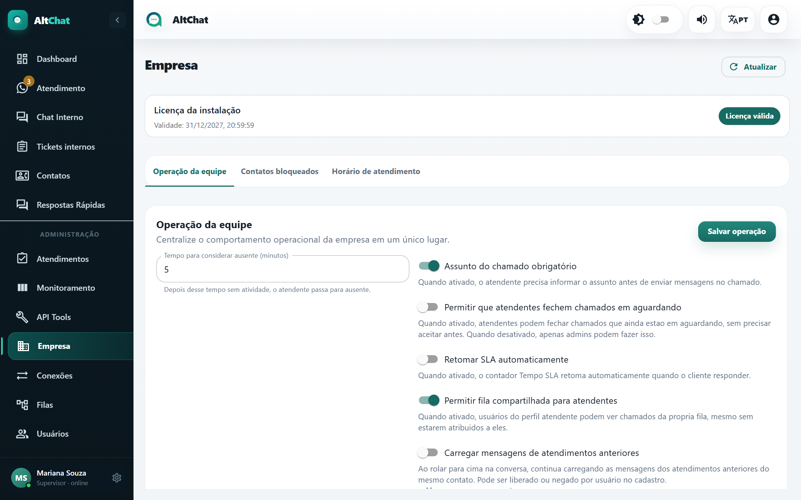
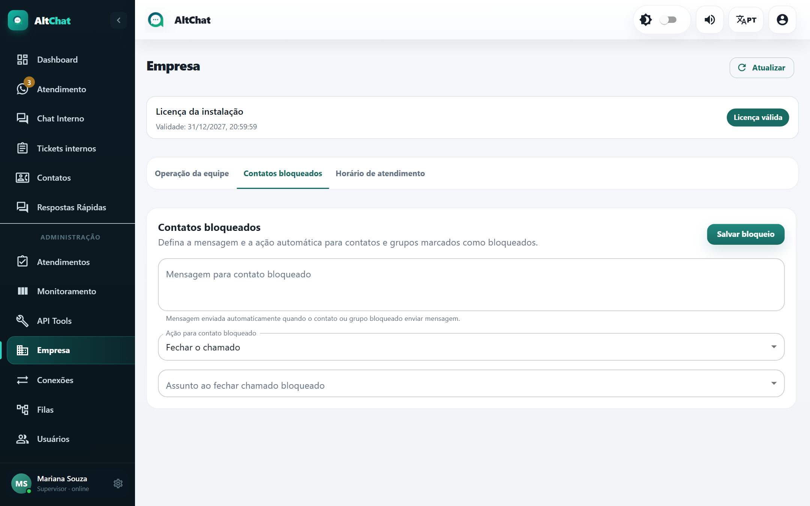
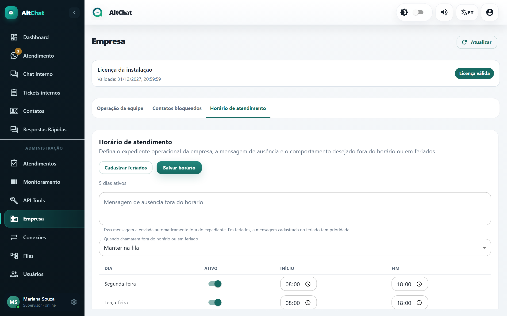
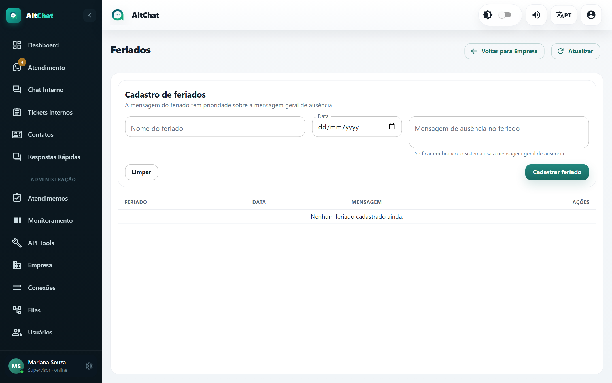

import { Steps, Aside } from '@astrojs/starlight/components';
import Perfil from '../../../components/Perfil.astro';

<Perfil tipo="admin" />

A tela **Empresa** reúne as regras gerais da operação em três abas. No topo aparece a validade da **licença** da instalação.

## Operação da equipe

| Opção | Efeito |
|---|---|
| **Tempo para considerar ausente (minutos)** | Sem atividade por esse tempo, o usuário passa de *online* para *ausente* (aparece no Monitoramento e na lista de Usuários). |
| **Assunto do chamado obrigatório** | O atendente precisa escolher um [assunto](/administradores/tags-e-assuntos/) para resolver. Sem isso, o botão Resolver encerra na hora. Recomendado se você quer os relatórios de motivos. |
| **Permitir que atendentes fechem chamados em aguardando** | Libera o botão *Fechar* na aba Aguardando para atendentes. Desligado, só administradores fecham sem aceitar. |
| **Retomar SLA automaticamente** | Se o atendente pausou o SLA, o contador volta sozinho quando o cliente responde. |
| **Permitir fila compartilhada para atendentes** | Atendentes veem os chamados da própria fila mesmo quando estão com outro colega. Pode ser sobrescrito por usuário em [Usuários](/administradores/usuarios/#opções-do-cadastro). |
| **Carregar mensagens de atendimentos anteriores** e **Mensagens por carregamento** | Mostra o histórico antigo do contato ao rolar a conversa. Entre 10 e 100 mensagens por vez. Também pode ser definido por usuário. |
| **Permitir espiar chamados aguardando** | Atendentes podem abrir a prévia de uma conversa aguardando sem aceitar. |
| **Permitir que atendentes ouçam gravações** | Reprodução de gravações de chamadas telefônicas dentro do atendimento (só com telefonia contratada). |

Clique em **Salvar operação** depois de alterar.

## Contatos bloqueados

Quando o recurso de bloqueio está liberado para a empresa, qualquer contato ou grupo pode ser marcado como **bloqueado** no cadastro de contatos. Aqui você define o que acontece quando ele escreve:

- **Mensagem para contato bloqueado**: resposta automática (pode ficar vazia para ignorar em silêncio).
- **Ação para contato bloqueado**: *Fechar o chamado* (a conversa é encerrada na hora) ou manter aguardando.
- **Assunto ao fechar chamado bloqueado**: o assunto registrado nesses encerramentos, para não poluir os relatórios.

Se a aba mostra *Recurso desabilitado*, o bloqueio não está contratado para a empresa; fale com o suporte do Altchat.

## Horário de atendimento

<Steps>
1. Marque os dias ativos e defina **Início** e **Fim** de cada um.
2. Escreva a **Mensagem de ausência fora do horário**. Ela é enviada automaticamente a quem escreve fora do expediente.
3. Escolha o que acontece com a conversa em **Quando chamarem fora do horário ou em feriado**: *Manter na fila* (o atendente vê no próximo turno) ou encerrar.
4. **Salvar horário**.
</Steps>

Filas com expediente diferente usam o horário próprio delas (veja [Filas](/administradores/filas/#horário-por-fila--horário-da-empresa)).

<Aside type="note" title="Não corta o atendimento">
O horário controla a mensagem automática e o destino da conversa nova. Atendentes logados fora do horário continuam vendo e respondendo normalmente.
</Aside>

## Feriados

Em **Cadastrar feriados**, informe **Nome**, **Data** e, se quiser, uma **Mensagem de ausência no feriado** própria ("Hoje não há expediente por causa do feriado de..."). Em branco, vale a mensagem geral. A mensagem do feriado tem prioridade sobre a do horário.

Cadastre os feriados nacionais e os municipais do ano de uma vez; a lista aceita quantos forem necessários.
