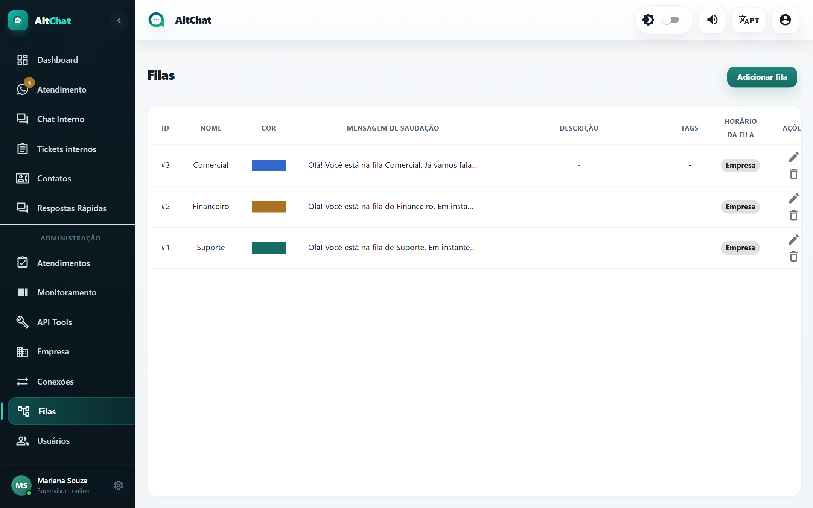
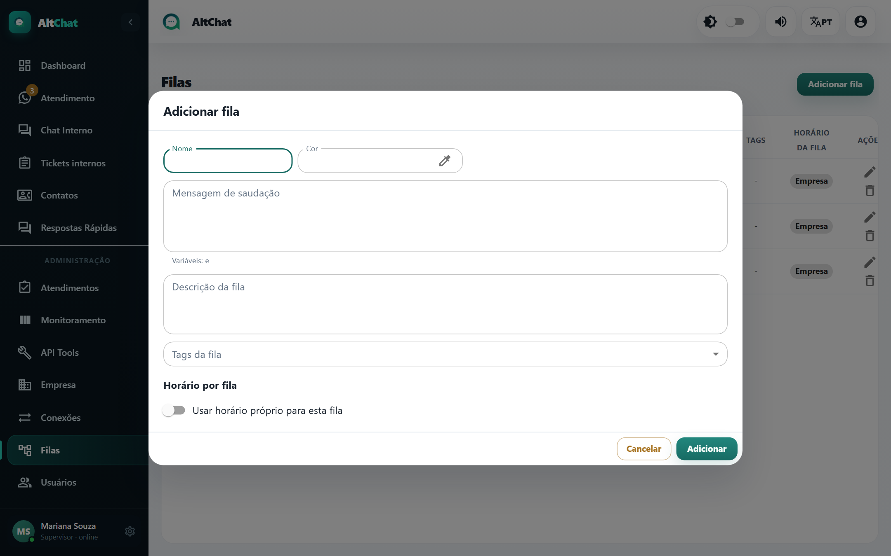
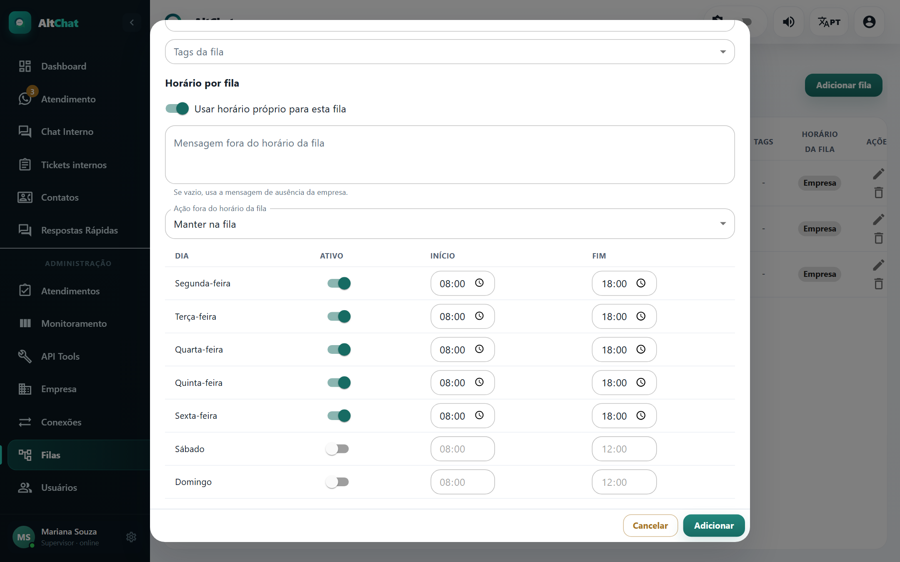

import { Steps, Aside } from '@astrojs/starlight/components';
import Perfil from '../../../components/Perfil.astro';

<Perfil tipo="admin" />

A fila é o setor que atende: Suporte, Financeiro, Comercial. Ela decide **quem vê** a conversa. Uma conversa sem fila só é vista por administradores.

## Como a conversa chega na fila

1. O cliente escreve para uma **conexão** (um número, o WebChat...).
2. Se a conexão tem **fila padrão**, a conversa cai nela direto.
3. Se não tem, o Altchat manda a **mensagem de saudação da conexão** com a lista de filas vinculadas e espera o cliente responder com o número da opção. Quando ele responde, a conversa vai para a fila escolhida e recebe a **saudação da fila**.
4. Enquanto o cliente não escolhe, a conversa fica *sem fila*.

## Criar uma fila

<Steps>
1. Em **Filas**, clique em **Adicionar fila**.

   

2. Preencha:
   - **Nome**: curto, como aparece para o cliente no menu de opções.
   - **Cor**: identifica a fila na lista de conversas (faixa colorida).
   - **Mensagem de saudação**: enviada quando a conversa entra na fila. Aceita variáveis como `{{name}}` (nome do contato).
   - **Descrição**: só para a equipe.
   - **Tags da fila**: tags sugeridas ou aplicadas aos atendimentos desta fila.
3. Se o setor tem expediente diferente da empresa, marque **Usar horário próprio para esta fila** e preencha os dias, horários, a mensagem fora do horário e o que fazer com a conversa (manter na fila ou encerrar).

   

4. **Adicionar**.
</Steps>

## Ligar a fila às conexões e às pessoas

Criar a fila não basta. Ela precisa estar em dois lugares:

- **Na conexão** (tela Conexões → editar → campo *Filas*): define em quais números a fila é oferecida ao cliente.
- **Nos usuários** (tela Usuários → editar → campo *Filas*): define quem atende.

Uma fila vinculada a uma conexão mas sem usuários acumula conversas que ninguém vê (exceto o administrador). Uma fila com usuários mas sem conexão nunca recebe conversa.

## Fila padrão

A **fila padrão** é definida na conexão, não na fila. Com ela, o cliente não recebe o menu de opções: cai direto no setor. Use quando o número é de um único setor ou quando um **chatbot** faz a triagem.

<Aside type="caution" title="Fila padrão e chatbots">
Com n8n ou Typebot ativo na conexão, é a fila padrão que diz ao Altchat "o bot está no controle". Marque a fila do bot como padrão da conexão e ligue *Interromper quando o chamado sair da fila padrão*: quando o atendente transfere para outra fila, o bot para. Sem fila padrão, o escopo do bot fica vazio e ele responde em qualquer fila. Detalhes em [Chatbots](/integracoes/chatbots/).
</Aside>

## Editar e apagar

Na lista, o lápis abre a mesma janela. A lixeira apaga a fila; os atendimentos dela ficam *sem fila* e passam a aparecer só para administradores. Transfira antes de apagar.

## Horário por fila × horário da empresa

| | Empresa | Fila |
|---|---|---|
| Onde configurar | Tela Empresa → Horário de atendimento | Janela da fila → Horário por fila |
| Vale para | Todas as conversas | Só as desta fila |
| Quando os dois existem | O da fila prevalece para as conversas dela | |
| Feriados | Cadastrados na tela Empresa, valem para todos | |
