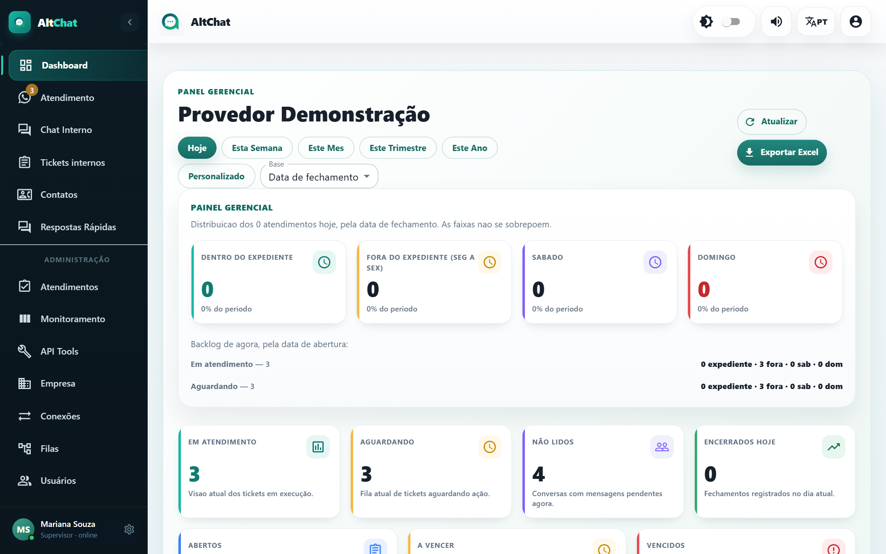

import { Steps, Aside, CardGrid, LinkCard } from '@astrojs/starlight/components';
import Perfil from '../../../components/Perfil.astro';

<Perfil tipo="admin" />

O administrador tem tudo o que o atendente tem e mais o grupo **Administração** no menu lateral. É ele quem monta a operação (conexões, filas, usuários), define as regras (horários, mensagens automáticas, prazos) e acompanha os resultados (Dashboard, Monitoramento, Atendimentos, Auditoria, Avaliações).

## Mapa do menu Administração

| Item | Para quê | Guia |
|---|---|---|
| **Atendimentos** | Histórico dos encerrados, ações em lote e resumo da carga por fila e atendente. | [Atendimentos](/administradores/atendimentos/) |
| **Monitoramento** | Quem está atendendo o quê, agora. | [Monitoramento](/administradores/monitoramento/) |
| **API Tools** | Ações HTTP executáveis de dentro do atendimento e credenciais da API oficial do WhatsApp. | [API Tools](/administradores/api-tools/) |
| **Empresa** | Comportamento da equipe, contatos bloqueados, horário de atendimento e feriados. | [Empresa](/administradores/empresa/) |
| **Conexões** | Números de WhatsApp, WebChat, Instagram e Messenger. | [Conexões](/administradores/conexoes/) |
| **Filas** | Setores de atendimento. | [Filas](/administradores/filas/) |
| **Usuários** | Pessoas da equipe, perfis e permissões. | [Usuários](/administradores/usuarios/) |
| **Ramais** | Só aparece quando a empresa contratou telefonia SIP. | [Ramais e chamadas](/administradores/ramais-e-chamadas/) |
| **Tags** e **Assuntos** | Listas de etiquetas e motivos de chamado. | [Tags e assuntos](/administradores/tags-e-assuntos/) |
| **Avaliações** | Notas que os clientes deram. | [Avaliações](/administradores/avaliacoes/) |
| **Auditoria** | Quem fez o quê, quando. | [Auditoria](/administradores/auditoria/) |
| **Configurações** | Ausência, fuso, transcrição de áudio, tokens, avaliações, mensagens automáticas e tempos de espera. | [Configurações](/administradores/configuracoes/geral-e-integracoes/) |

## Montando a operação do zero

A ordem importa, porque cada tela depende da anterior.

<Steps>
1. **Filas**: crie os setores (Suporte, Financeiro, Comercial). Sem fila não há para onde mandar as conversas. [Filas](/administradores/filas/)
2. **Conexão**: cadastre o número de WhatsApp (por QR Code ou API oficial) e vincule as filas a ele. Decida a fila padrão e a mensagem de saudação. [Conexões](/administradores/conexoes/)
3. **Usuários**: crie a equipe, escolha o perfil e coloque cada pessoa nas filas certas. [Usuários](/administradores/usuarios/)
4. **Empresa**: horário de atendimento, mensagem fora do horário, feriados e as opções de operação (assunto obrigatório, fila compartilhada, espiar aguardando). [Empresa](/administradores/empresa/)
5. **Configurações**: mensagens automáticas de aceite e transferência, tempos de espera, avaliação ao encerrar. [Configurações](/administradores/configuracoes/mensagens-automaticas/)
6. **Tags e Assuntos**: padronize como a equipe classifica os chamados. [Tags e assuntos](/administradores/tags-e-assuntos/)
7. Faça um atendimento de teste de ponta a ponta com um celular pessoal antes de divulgar o número.
</Steps>

<Aside type="tip" title="Supervisor sem acesso à administração">
Se alguém precisa acompanhar a equipe (ver todos os atendimentos, transferir, resolver) sem mexer em configurações, crie o usuário com perfil **Atendente** e ligue **Modo supervisor** no cadastro. Veja [Usuários](/administradores/usuarios/).
</Aside>

## Acompanhando o dia a dia

<CardGrid>
	<LinkCard title="Monitoramento" description="A carga viva: quem está com quantos atendimentos e o que está esperando na fila." href="/administradores/monitoramento/" />
	<LinkCard title="Dashboard" description="Números do período: volume, tempos médios, motivos, ranking de atendentes." href="/administradores/dashboard/" />
	<LinkCard title="Atendimentos" description="Histórico com filtros, exportação para Excel e ações em lote." href="/administradores/atendimentos/" />
	<LinkCard title="Auditoria" description="Rastro de tudo o que a equipe fez no sistema." href="/administradores/auditoria/" />
</CardGrid>
