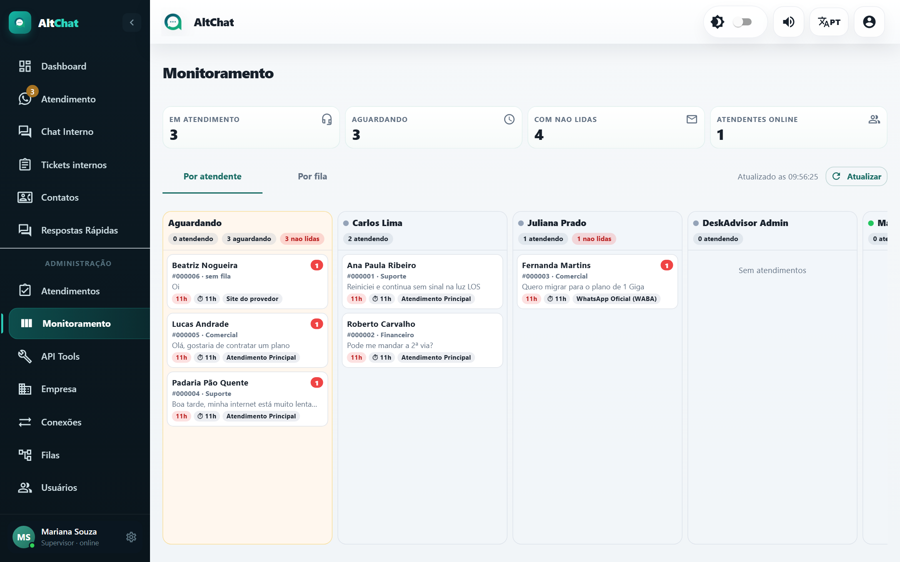
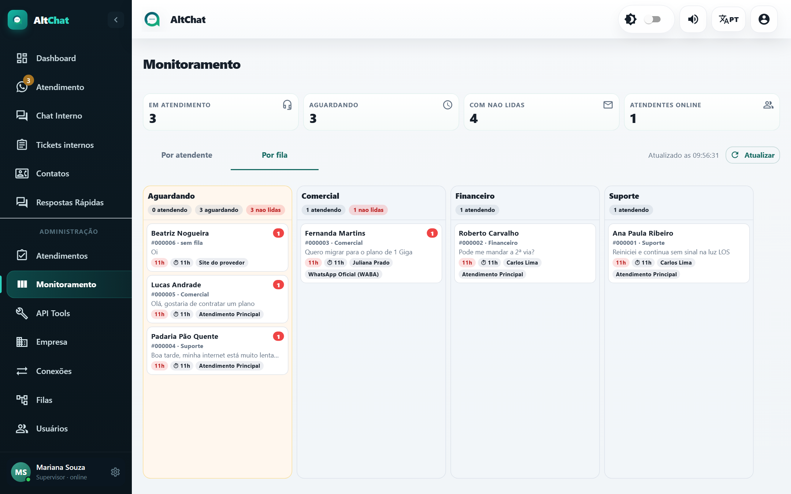

import { Aside } from '@astrojs/starlight/components';
import Perfil from '../../../components/Perfil.astro';

<Perfil tipo="admin" />

O Dashboard olha para o passado; o **Monitoramento** olha para agora. É a tela para deixar aberta num monitor da supervisão.

## Os quatro números do topo

| Card | O que conta |
|---|---|
| **Em atendimento** | Conversas aceitas por alguém e ainda não resolvidas. |
| **Aguardando** | Conversas que chegaram e ninguém aceitou. |
| **Com não lidas** | Conversas com mensagem do cliente sem leitura, em qualquer estado. |
| **Atendentes online** | Usuários logados e ativos (não ausentes). |

A tela se atualiza sozinha; a hora da última atualização aparece ao lado do botão **Atualizar**.

## Por atendente

Cada atendente aparece com quantos atendimentos tem e quantos estão com mensagem não lida. Abaixo, a lista das conversas dele: cliente, número do atendimento, fila, última mensagem, há quanto tempo o cliente espera (⏱) e a conexão. O bloco **Aguardando**, no topo, lista o que ainda não tem dono.

Use para:

- Ver quem está sobrecarregado e quem está livre antes de transferir.
- Achar conversas paradas: um ⏱ alto em "Em atendimento" significa que o cliente espera resposta do atendente.
- Conferir quem está online no começo do turno.

## Por fila

Mesmos dados, agrupados por fila. Mostra rapidamente qual setor está com gargalo e se há conversas **sem fila** (chegaram por uma conexão sem fila padrão e o cliente não escolheu). Conversas sem fila só aparecem para administradores: trate-as transferindo para a fila certa.

<Aside type="tip" title="Ação direta">
Clique na conversa para abri-la na tela de Atendimento. Como administrador você pode transferir, resolver ou devolver à fila qualquer atendimento, mesmo que seja de outra pessoa.
</Aside>

## Diferença para "Resumo por fila e atendente"

A aba *Resumo* da tela [Atendimentos](/administradores/atendimentos/#resumo-por-fila-e-atendente) traz os mesmos totais em forma de tabela, com o mais antigo e o tempo médio de espera por fila. O Monitoramento é a visão conversa a conversa; o Resumo é a visão agregada.
