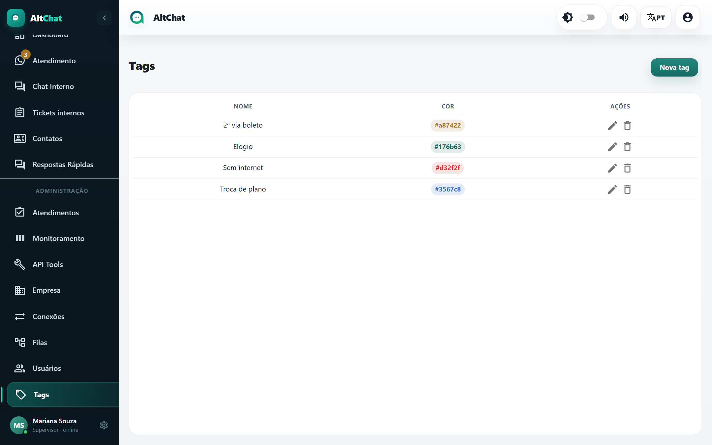
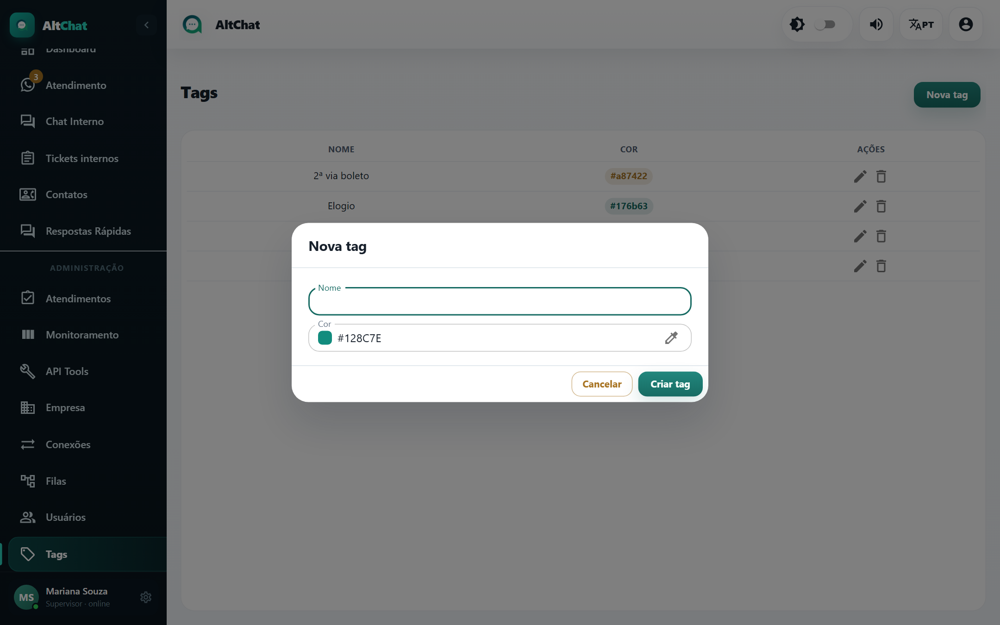
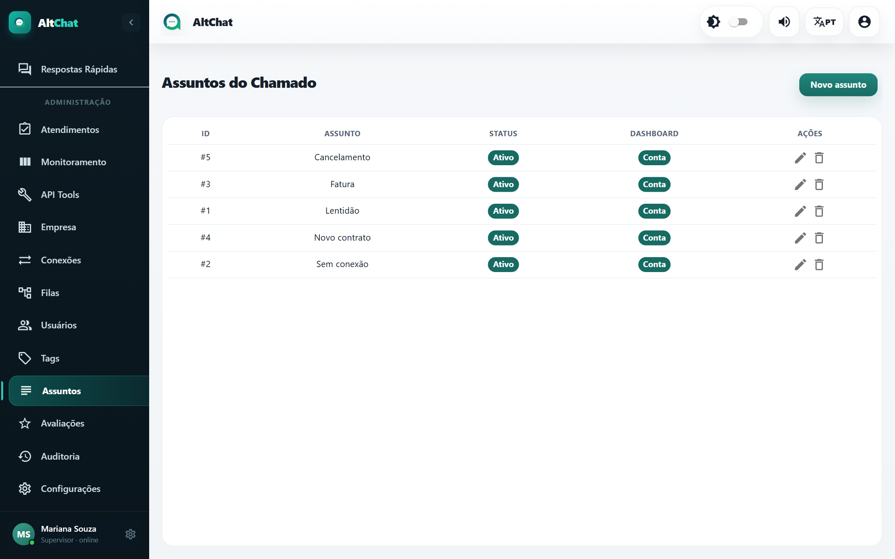
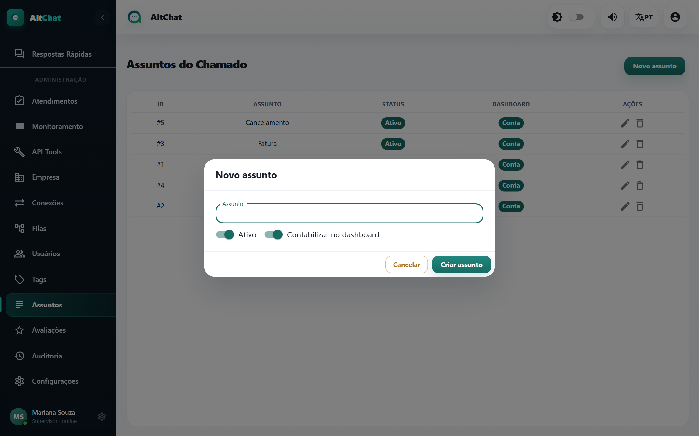

import { Steps, Aside } from '@astrojs/starlight/components';
import Perfil from '../../../components/Perfil.astro';

<Perfil tipo="admin" />

Como o atendente usa tags e assuntos está em [Tags e assuntos (atendente)](/atendentes/tags-e-assuntos/). Esta página é sobre o cadastro das listas.

## Tags

<Steps>
1. Em **Tags**, clique em **Nova tag**.

   

2. Dê um **Nome** curto e escolha a **Cor**. A cor aparece na etiqueta do atendimento e nos filtros.
3. **Criar tag**.
</Steps>

Editar muda o nome em todos os atendimentos que já têm a tag. Apagar remove a tag do cadastro **e dos atendimentos vinculados**.

Sugestão de conjunto inicial para provedor: *Sem internet*, *Lentidão*, *2ª via boleto*, *Troca de plano*, *Mudança de endereço*, *Cancelamento*, *Elogio*, *Reclamação*.

## Assuntos do chamado

<Steps>
1. Em **Assuntos**, clique em **Novo assunto**.

   

2. Escreva o **Assunto**. Para agrupar por categoria no Dashboard, use o formato *Categoria — Assunto* (com travessão): *Suporte — Sem conexão*, *Financeiro — Fatura*.
3. **Ativo**: desmarque para esconder da lista sem apagar o histórico.
4. **Contabilizar no dashboard**: desmarque para assuntos administrativos (por exemplo, o assunto usado em encerramentos automáticos de contatos bloqueados).
5. **Criar assunto**.
</Steps>

Para obrigar o atendente a escolher um assunto ao resolver, ligue **Assunto do chamado obrigatório** na tela [Empresa](/administradores/empresa/#operação-da-equipe).

<Aside type="tip" title="Tag ou assunto?">
Use **assunto** para o motivo principal, um por atendimento, que vira relatório. Use **tags** para qualquer marcação extra, quantas forem. Uma lista de assuntos com 8 a 15 itens costuma ser o tamanho certo; mais que isso, o atendente para de escolher com cuidado.
</Aside>
