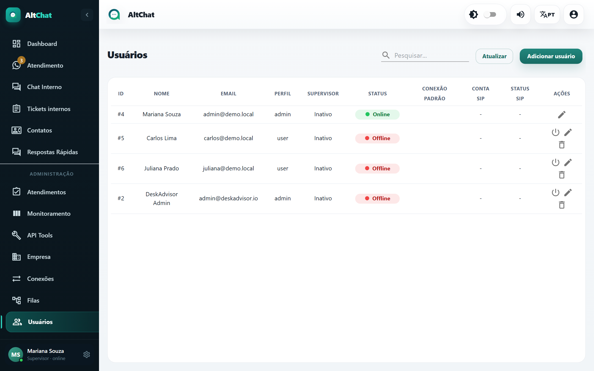
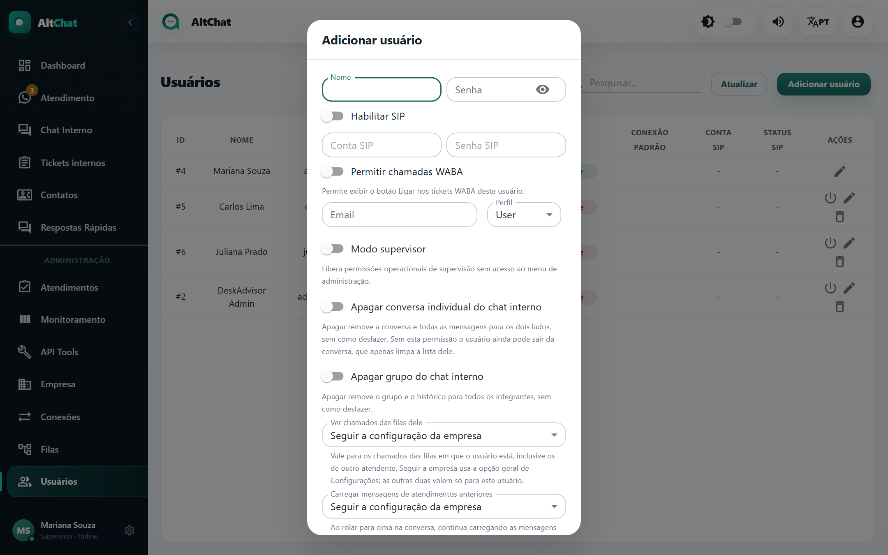

import { Steps, Aside } from '@astrojs/starlight/components';
import Perfil from '../../../components/Perfil.astro';

<Perfil tipo="admin" />

A lista mostra ID, nome, e-mail, perfil, se é supervisor, se está **online**, a conexão padrão e os dados de ramal (quando a empresa usa telefonia). O botão **Desconectar usuário** derruba a sessão de alguém na hora (útil quando a pessoa esqueceu de sair num computador compartilhado).

## Criar um usuário

<Steps>
1. Clique em **Adicionar usuário**.

   

2. Preencha **Nome**, **Email** (é o login) e **Senha**. Oriente a pessoa a trocar a senha no primeiro acesso.
3. Escolha o **Perfil**: **User** (atendente) ou **Admin** (administrador). O que cada um pode fazer está em [Perfis e permissões](/comece-aqui/perfis-e-permissoes/).
4. Selecione as **Filas** que a pessoa atende. Sem fila, ela não vê nenhuma conversa.
5. Se a empresa tem mais de uma conexão, escolha a **Conexão Padrão**: é o número usado quando a pessoa inicia uma conversa pelo botão *Novo*.
6. Ligue as opções que fizerem sentido (tabela abaixo) e clique em **Adicionar**.
</Steps>

## Opções do cadastro

| Opção | O que faz |
|---|---|
| **Modo supervisor** | Dá a um atendente as permissões operacionais de supervisão (ver todos os atendimentos das suas filas, transferir e resolver os de colegas) sem mostrar o menu Administração. É o perfil certo para líder de equipe. |
| **Ver chamados das filas dele** | Três estados: *Seguir a configuração da empresa* (usa a opção *Permitir fila compartilhada* da tela Empresa), *Sim* ou *Não*. Com *Não*, o atendente vê só os atendimentos atribuídos a ele e os que estão aguardando. |
| **Carregar mensagens de atendimentos anteriores** | Três estados. Com *Sim*, ao rolar a conversa para cima o atendente vê as conversas antigas do mesmo contato, separadas por marcadores de ticket. |
| **Apagar conversa individual do chat interno** / **Apagar grupo do chat interno** | Permite apagar conversas internas para os dois lados (sem volta). Sem a permissão, o usuário só consegue *sair* da conversa. |
| **Permitir chamadas WABA** | Mostra o botão *Ligar* nos atendimentos da API oficial, quando a empresa contratou chamadas. |
| **Habilitar SIP**, **Conta SIP**, **Senha SIP** | Vincula o usuário a um ramal de telefonia. Veja [Ramais e chamadas](/administradores/ramais-e-chamadas/). |

<Aside type="tip" title="Supervisor ou administrador?">
Use **Admin** para quem configura o sistema. Use **User + Modo supervisor** para quem só acompanha e redistribui o atendimento. Isso evita que um líder de equipe mude por engano uma conexão ou uma mensagem automática.
</Aside>

## Editar, desativar, apagar

- O lápis abre o cadastro. Trocar a senha por aqui é a forma de recuperar o acesso de quem esqueceu.
- Não existe "desativar": para tirar alguém da operação sem apagar, remova as filas e **Desconectar usuário**. O histórico de atendimentos continua com o nome da pessoa.
- A lixeira apaga o usuário. Os atendimentos abertos dele ficam sem responsável (voltam para *Aguardando* nas filas). Transfira antes.

## Limite de usuários

O número de usuários que a empresa pode criar faz parte do contrato. Ao atingir o limite, o botão *Adicionar usuário* devolve um erro. Fale com o suporte do Altchat para ampliar.
