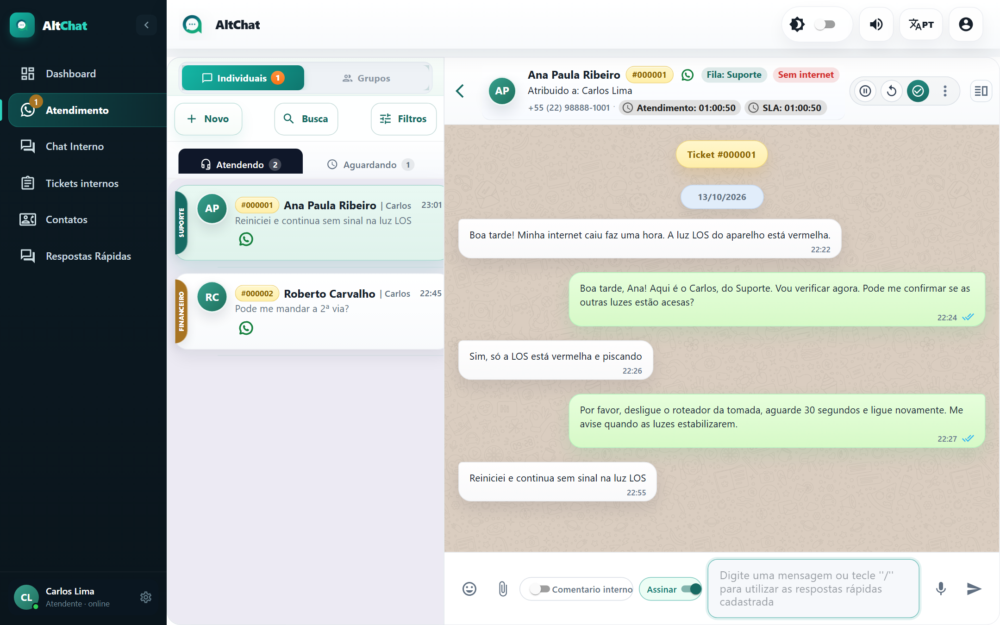
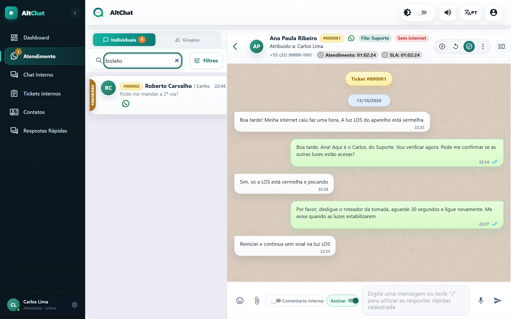
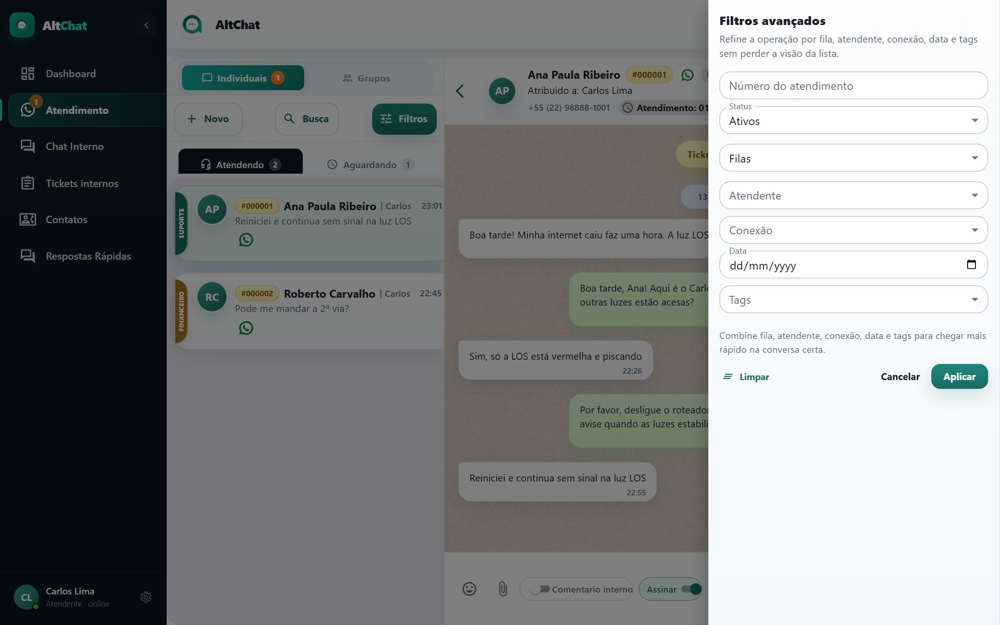
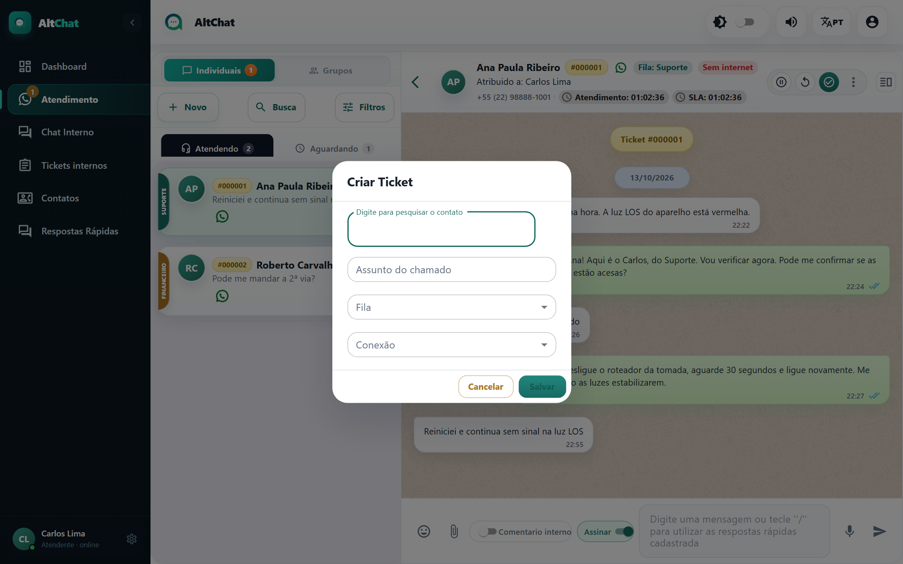

import { Steps, Aside } from '@astrojs/starlight/components';
import Perfil from '../../../components/Perfil.astro';

<Perfil tipo="atendente" />

## As abas

| Aba | Mostra | Contador |
|---|---|---|
| **Atendendo** | Conversas em andamento. As suas e, se o seu usuário tem *Ver atendimentos da fila*, as dos colegas das mesmas filas. | Quantas têm mensagem não lida. |
| **Aguardando** | Conversas que chegaram e ninguém aceitou. Só das suas filas. | Quantas estão esperando. |

Acima delas há outro par de abas, **Individuais** e **Grupos**, que separa conversas de pessoas das conversas de grupos do WhatsApp. Os contadores do menu lateral (item **Atendimento**) somam não lidas e aguardando das suas filas.

<Aside type="tip">
A lista é ordenada pela **última mensagem**: quem falou por último sobe. Um atendimento que você já respondeu desce até o cliente responder de novo.
</Aside>

## Busca

Serve para achar qualquer atendimento, inclusive os já resolvidos, pelo nome do cliente, número ou **trecho de mensagem**.

<Steps>
1. Clique em **Busca**, acima da lista. A caixa *Buscar tickets e mensagens* toma o lugar dos botões.
2. Digite ao menos três letras. A lista passa a mostrar os atendimentos que combinam, de qualquer status.
3. Clique no atendimento para abrir. Se estiver resolvido, você verá o histórico e o botão **Reabrir**.
</Steps>

## Filtros avançados

<Steps>
1. Clique em **Filtros**.
2. Combine o que precisar: **Número do atendimento**, **Status** (Ativos, Atendendo, Aguardando, Resolvidos), **Filas**, **Atendente**, **Conexão**, **Data** e **Tags**.
3. Clique em **Aplicar**. O botão *Filtros* passa a mostrar quantos filtros estão ativos. **Limpar** volta ao normal.
</Steps>

Usos comuns:

- *Status: Resolvidos* + *Data: hoje* para rever o que você encerrou no dia.
- *Tags: Sem internet* + *Status: Ativos* para ver todos os chamados de queda abertos agora.
- *Número do atendimento* quando o cliente informa o protocolo.

## Abrir uma conversa com quem ainda não escreveu (Novo)

<Steps>
1. Clique em **Novo**.
2. Digite o nome ou o número do contato. Se não existir, **Adicionar** cria o contato na hora.
3. Escolha a fila e a conexão e clique em **Salvar**. O atendimento nasce já na aba Atendendo, com você como responsável.
</Steps>

<Aside type="caution" title="Conexões pela API oficial (WABA)">
Numa conexão oficial, iniciar a conversa só é possível com um **template** aprovado pela Meta, e o cliente precisa responder para abrir a janela de 24 horas. Fora disso, a mensagem não sai. No WhatsApp por QR Code não há essa restrição.
</Aside>
