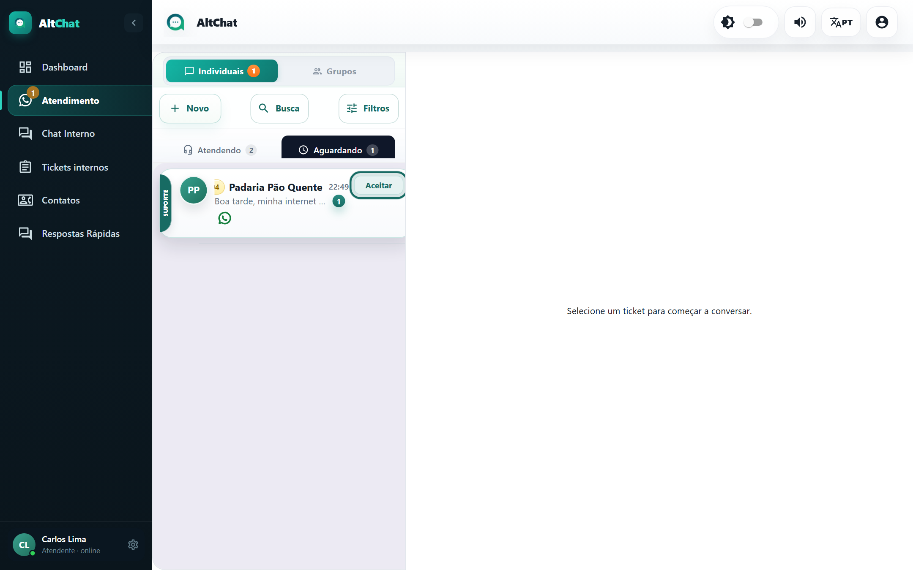
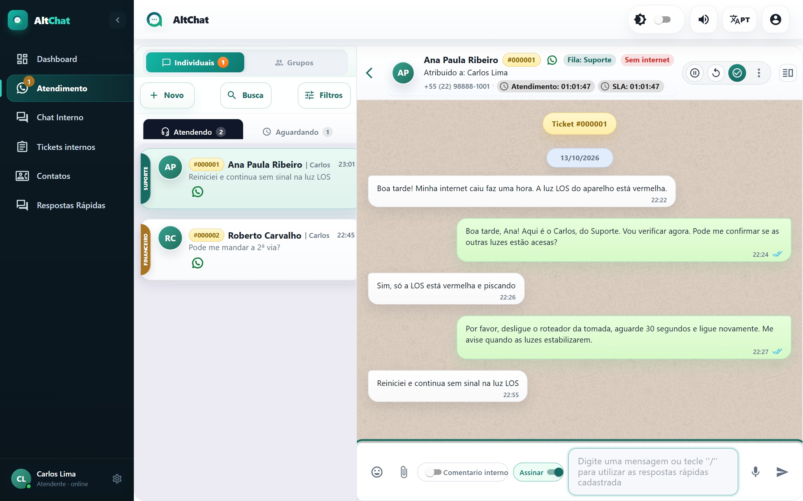
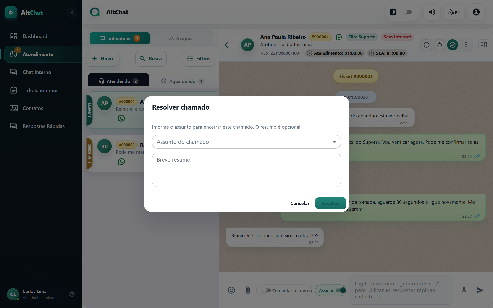
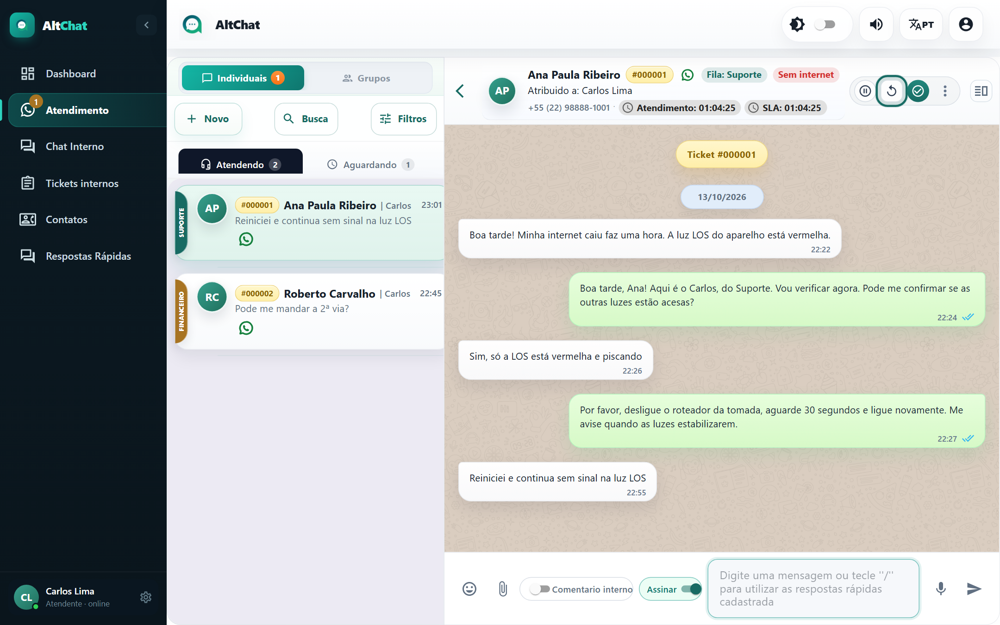

import { Steps, Aside } from '@astrojs/starlight/components';
import Perfil from '../../../components/Perfil.astro';

<Perfil tipo="atendente" />

Este é o guia mais importante do manual. Ele cobre o que você faz dezenas de vezes por dia: pegar uma conversa da fila, conversar e encerrar.

## Antes de começar

- Você precisa estar em pelo menos uma **fila**. Quem coloca você nas filas é o administrador.
- Deixe os **sons** ligados. O aviso de mensagem nova toca mesmo com o navegador em segundo plano.

## A tela de atendimento

A tela tem duas partes. À **esquerda**, a lista de conversas, com as abas **Atendendo** (as suas) e **Aguardando** (as que ninguém pegou). À **direita**, a conversa selecionada: cabeçalho com os dados do cliente e os botões de ação, as mensagens e, embaixo, a caixa para escrever.

Cada item da lista mostra a fila (faixa colorida na borda), o número do atendimento, o nome do cliente, quem está atendendo, a hora da última mensagem e um contador de não lidas.

## Aceitar

<Steps>
1. Clique na aba **Aguardando**. O número ao lado da aba é quantas conversas estão esperando nas suas filas.
2. Passe o mouse sobre a conversa. Aparecem três ações: **Espiar chamado** (ler sem aceitar), **Fechar** (encerrar sem atender) e **Aceitar**.

   

3. Clique em **Aceitar**. A conversa passa para a aba **Atendendo**, com o seu nome como responsável, e o cliente pode receber a mensagem automática de aceite, se o administrador configurou uma.
</Steps>

<Aside type="tip" title="Espiar antes de aceitar">
**Espiar chamado** abre a conversa só para leitura e não marca como lida. Use para decidir se o atendimento é da sua alçada antes de assumir. Na aba Atendendo existe o equivalente **Espiar sem marcar como lida**.
</Aside>

## Responder

<Steps>
1. Com a conversa aberta, clique na caixa **Digite uma mensagem** na parte de baixo.
2. Escreva e pressione <kbd>Enter</kbd> para enviar. <kbd>Shift</kbd> + <kbd>Enter</kbd> quebra a linha sem enviar.
3. Confira os tiques ao lado da hora: um cinza é *enviada*, dois cinzas é *entregue*, dois azuis é *lida*.
</Steps>

Na caixa de mensagem você também tem:

| Controle | O que faz | Guia |
|---|---|---|
| 😀 | Abre o seletor de emojis. | |
| 📎 | Anexa foto, documento, vídeo ou áudio. Também aceita arrastar e soltar. | [Mídia e arquivos](/atendentes/midia-e-arquivos/) |
| **Comentário interno** | Escreve uma anotação que o cliente **não** recebe. | [Anotações internas](/atendentes/anotacoes-internas/) |
| **Assinar** | Coloca o seu nome no início de cada mensagem. Fica ligado por padrão. | |
| `/` | Abre as respostas rápidas. | [Respostas rápidas](/atendentes/respostas-rapidas/) |
| 🎤 | Grava um áudio. | [Mídia e arquivos](/atendentes/midia-e-arquivos/) |

<Aside type="note" title="Responder, editar e apagar uma mensagem">
Passe o mouse sobre uma mensagem e clique na seta que aparece. Dá para **Responder** (cita a mensagem), **Editar** e **Deletar** mensagens suas. O WhatsApp limita a edição a alguns minutos depois do envio; passado o prazo, o Altchat avisa.
</Aside>

## Encerrar (Resolver)

<Steps>
1. No cabeçalho da conversa, clique no botão verde com o **✓** (Resolver).

   

2. Se a sua empresa exige **assunto** ao encerrar, abre a janela **Resolver chamado**. Escolha o **Assunto do chamado** na lista e, se quiser, escreva um **Breve resumo** do que foi feito (o resumo é opcional). Se a empresa não exige, o atendimento é encerrado na hora, sem janela.

   

3. Confirme. O atendimento sai da lista. Se a empresa usa **avaliação**, o cliente recebe agora a pergunta de nota, e se tem **mensagem de despedida** na conexão, ela é enviada.
</Steps>

<Aside type="caution" title="Resolver não pede confirmação">
Quando a empresa não exige assunto, um clique no ✓ encerra o atendimento imediatamente. Se encerrou por engano, procure a conversa pela **Busca** e clique em **Reabrir**.
</Aside>

Depois de resolvido, o atendimento continua acessível pela **Busca** e pelos **Filtros** com status *Resolvidos*. Lá dentro, o botão **Reabrir** traz a conversa de volta para a aba Atendendo, com você como responsável.

## Devolver para a fila (Retornar)

Pegou uma conversa que não é sua? Clique no botão **↺** (Retornar) no cabeçalho. O atendimento volta para **Aguardando**, sem responsável, e outro colega pode aceitar. Para mandar direto para outra fila ou pessoa, use [Transferir](/atendentes/transferir/).

## Problemas comuns

- **A conversa não aparece para mim.** Ela está em uma fila da qual você não faz parte, ou o seu usuário não tem a opção *Ver atendimentos da fila*. Fale com o administrador.
- **A caixa de mensagem diz "Reabra ou aceite esse ticket".** Você está vendo (espiando) um atendimento que não é seu ou que já foi resolvido. Aceite ou reabra para escrever.
- **Mandei e ficou com um tique só.** O telefone do cliente está sem internet, ou a conexão do WhatsApp da empresa caiu. Se vários clientes ficarem assim ao mesmo tempo, avise o administrador: a tela **Conexões** mostra o estado.
- **Enviei por engano.** Use **Deletar** no menu da mensagem. O cliente vê "mensagem apagada".
