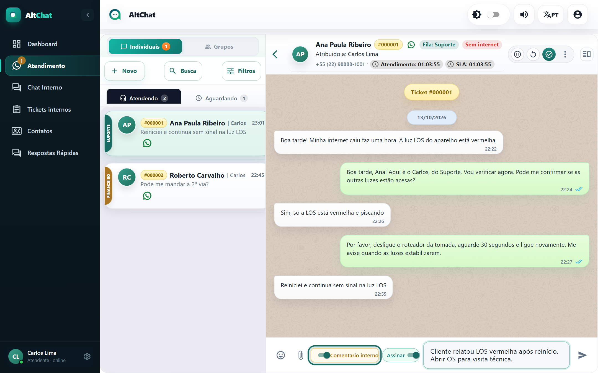
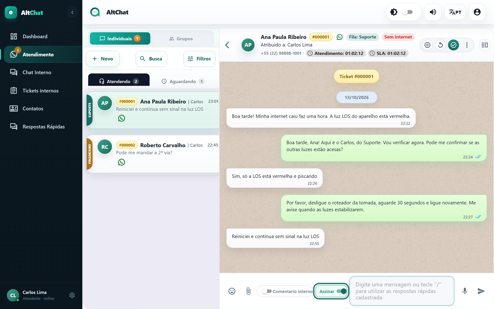
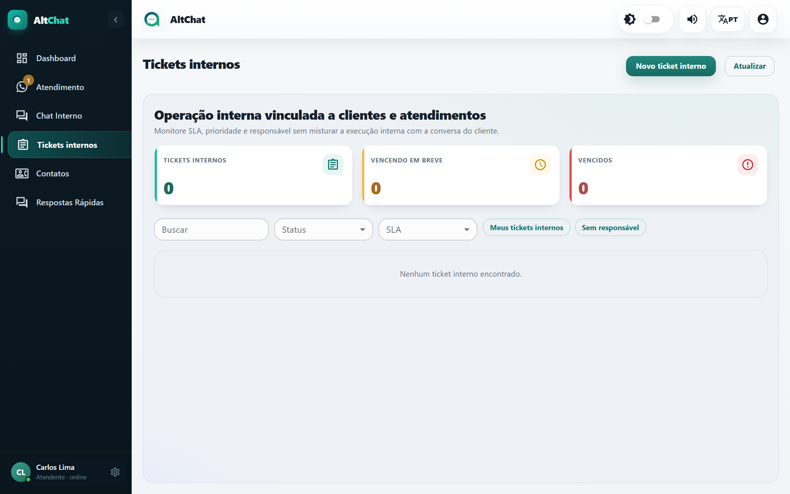

import { Steps, Aside } from '@astrojs/starlight/components';
import Perfil from '../../../components/Perfil.astro';

<Perfil tipo="atendente" />

## Comentário interno

Um comentário interno é uma mensagem que **fica no atendimento mas não vai para o cliente**. Serve para registrar o que você apurou, deixar instrução para quem vai continuar depois da transferência ou anotar um protocolo de outro sistema.

<Steps>
1. Ligue a chave **Comentário interno**, à esquerda da caixa de mensagem. A chave fica destacada em dourado para avisar que você está no modo interno.
2. Escreva normalmente e envie. A anotação aparece na conversa com fundo diferente, visível só para a equipe.
3. Desligue a chave para voltar a falar com o cliente.
</Steps>

<Aside type="caution" title="Confira a chave antes de enviar">
A chave vale para a mensagem seguinte e continua ligada até você desligar. Antes de responder ao cliente depois de uma anotação, olhe a cor da caixa.
</Aside>

Além das suas anotações, o Altchat pode gravar anotações automáticas: quando o administrador liga a opção *Armazenar mensagens de aceite e transferência como anotações*, cada aceite e cada transferência deixa um registro na conversa com data, hora e quem fez.

## Assinatura

Com a chave **Assinar** ligada (padrão), cada mensagem sai com o seu nome na primeira linha, em negrito. O cliente sabe com quem está falando, e numa equipe que divide o mesmo número isso evita confusão.

Desligue quando for enviar algo em nome da empresa, e não seu (um comunicado, por exemplo). A chave fica desligada só nesta conversa, até você ligar de novo.

## Tickets internos

Quando a anotação vira uma **tarefa** para outra pessoa ou outro setor (enviar um técnico, ajustar uma fatura), use um **ticket interno** em vez de um comentário: ele tem responsável, prioridade e prazo, e fica vinculado ao atendimento. Abra pelo menu **⋮ → Tickets internos** na conversa, ou pela tela *Tickets internos* no menu lateral.

