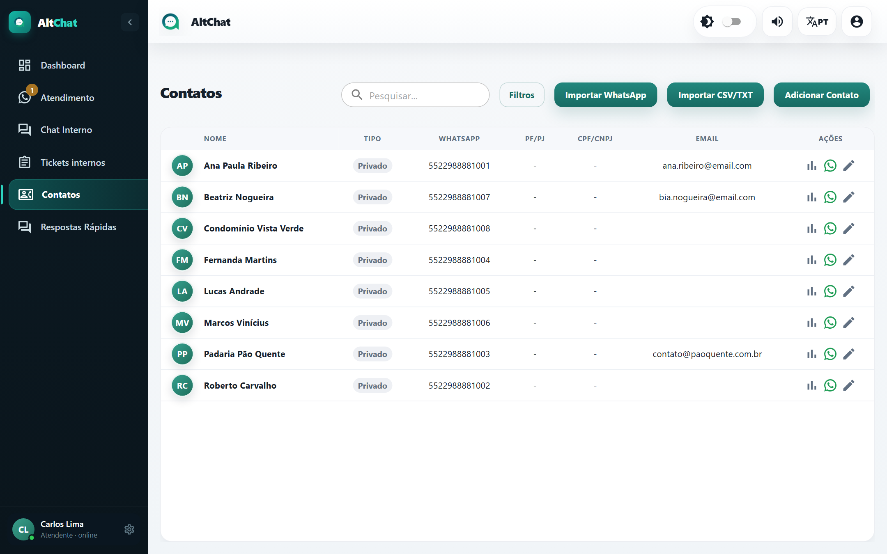
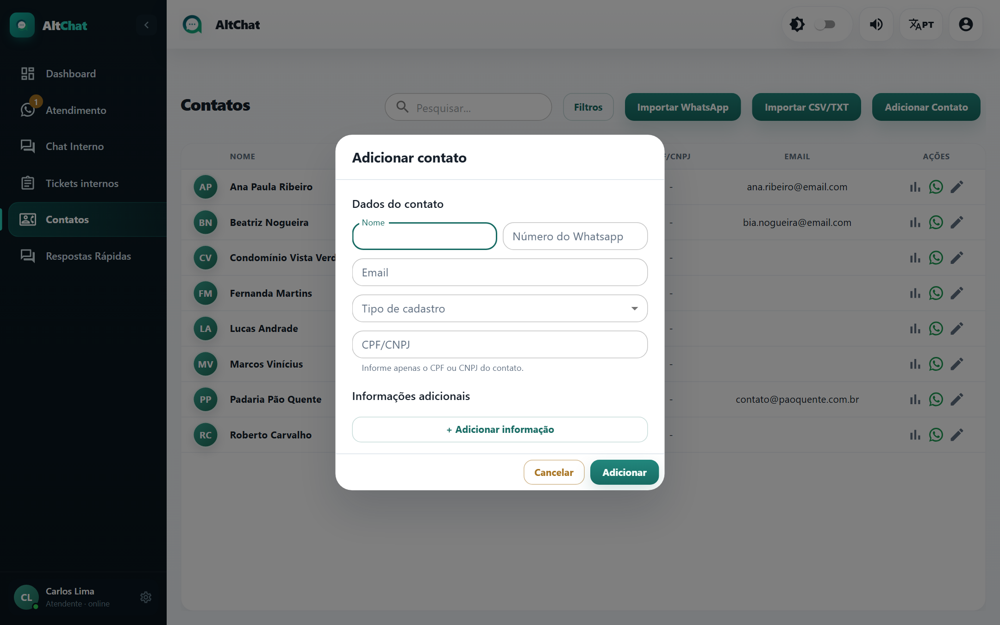
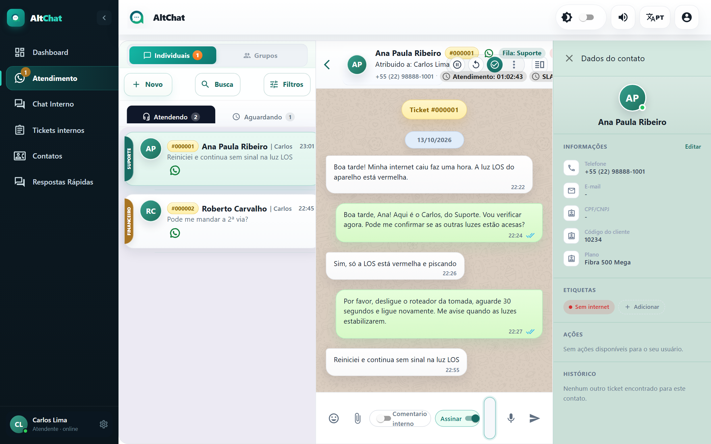

import { Steps, Aside } from '@astrojs/starlight/components';
import Perfil from '../../../components/Perfil.astro';

<Perfil tipo="atendente" />

Todo cliente que escreve vira um **contato** automaticamente, com o nome do perfil do WhatsApp. A tela Contatos serve para corrigir esses dados, cadastrar alguém antes do primeiro contato e consultar o histórico.

## A lista

- **Pesquisar** procura por nome, número ou e-mail.
- **Filtros** refina por tipo (pessoa física ou jurídica) e outros campos.
- **Importar WhatsApp** puxa a agenda do telefone conectado por QR Code. **Importar CSV/TXT** carrega uma planilha.
- Em cada linha: **Ver histórico do contato**, editar e, para administradores, apagar.

## Cadastrar um contato

<Steps>
1. Clique em **Adicionar Contato**.
2. Preencha **Nome** e **Número** com DDI e DDD, só dígitos (ex.: `5522988881001`). E-mail é opcional.
3. Escolha **Tipo de cadastro** (pessoa física ou jurídica) e o **CPF/CNPJ**, se a empresa usa esse dado.
4. Em **Outras informações**, adicione campos personalizados: *Código do cliente*, *Plano*, *Endereço da instalação*. Eles aparecem no painel de detalhes durante o atendimento.
5. Salve.
</Steps>

## Ver os dados durante o atendimento

Na conversa, clique no ícone **Mostrar detalhes** no canto direito do cabeçalho. Abre um painel com três abas:

- **Dados**: cadastro, campos personalizados e botão *Editar contato*.
- **Operação**: atendimentos abertos e informações operacionais.
- **Histórico**: todos os atendimentos anteriores deste contato, com data e resultado.

<Aside type="note" title="Contatos do app do assinante">
Clientes que chegam pelo **app do provedor** entram com o código do cliente e sem número de WhatsApp editável. Aparece o aviso *Este contato foi aberto pelo app do assinante* se você tentar mudar o número. É esperado.
</Aside>

## Bloquear um contato

Se a empresa liberou o bloqueio, o administrador pode marcar um contato como bloqueado na aba **Contatos bloqueados** da tela Empresa. As mensagens dele deixam de abrir atendimento.

## Problemas comuns

- **Aparecem dois contatos para a mesma pessoa, um deles sem número.** O WhatsApp passou a identificar alguns contatos por um código interno (LID) em vez do número. O Altchat junta os dois automaticamente assim que o número é confirmado; se persistir, avise o administrador.
- **O nome do contato mudou sozinho.** O nome vem do perfil do WhatsApp do cliente. Edite o contato e salve o nome correto; o Altchat passa a manter o que você digitou.
