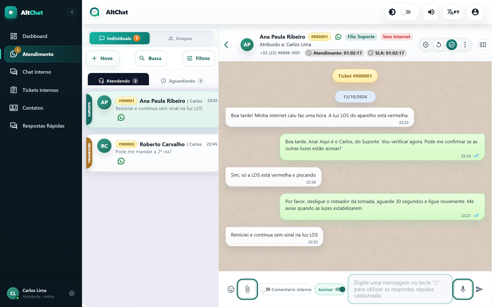

import { Steps, Aside } from '@astrojs/starlight/components';
import Perfil from '../../../components/Perfil.astro';

<Perfil tipo="atendente" />

## Enviar um arquivo

<Steps>
1. Clique no **clipe** (📎) ao lado da caixa de mensagem e escolha o arquivo. Ou simplesmente **arraste o arquivo** para dentro da conversa: aparece o aviso *Solte o arquivo para anexar*.
2. Confira a prévia. Dá para anexar até **5 arquivos** de uma vez; a partir do sexto o Altchat avisa que só os cinco primeiros entraram.
3. Escreva uma legenda, se quiser, e envie.
</Steps>

## Gravar um áudio

<Steps>
1. Clique no **microfone** (🎤). O navegador pode pedir permissão para usar o microfone na primeira vez; aceite.
2. Fale. O contador mostra a duração.
3. Clique em **enviar** para mandar, ou na lixeira para descartar.
</Steps>

<Aside type="tip" title="Transcrição de áudio">
Se o administrador ativou a **transcrição**, os áudios que o cliente manda aparecem com o texto embaixo, e dá para ler sem ouvir. A transcrição é feita por um serviço de IA e pode levar alguns segundos.
</Aside>

## Receber

Fotos e vídeos aparecem na conversa e abrem em tamanho maior ao clicar. Documentos têm um botão de download. Áudios tocam dentro da conversa. Localizações aparecem como um mapa pequeno; contatos compartilhados (vCard), como um cartão.

## Limites por canal

| Canal | O que vai | O que não vai |
|---|---|---|
| **WhatsApp (QR Code)** | Fotos, vídeos, áudios, documentos de qualquer tipo, figurinhas. | Arquivos muito grandes (o WhatsApp limita a cerca de 100 MB). |
| **WhatsApp API oficial (WABA)** | Fotos, vídeos, áudios e documentos comuns (PDF, Office, imagens). | **Arquivos .zip e .rar**: a Meta recusa. Compacte em PDF ou envie um link. |
| **WebChat (site e app)** | Só **texto e links**. | Qualquer arquivo, foto ou áudio: o Altchat avisa *O WebChat ainda não envia arquivos*. Mande um link. |
| **Instagram e Messenger** | Fotos e texto. | Documentos. |

## Problemas comuns

- **"O arquivo foi recusado"** numa conexão oficial: é quase sempre um .zip. Troque o formato.
- **O áudio não grava.** O navegador bloqueou o microfone. Clique no cadeado ao lado do endereço do site e permita.
- **A foto chegou sem abrir (quadrado cinza).** A conexão por QR Code teve uma falha momentânea ao baixar a mídia. Peça ao cliente para reenviar; se acontecer com todos, avise o administrador.
