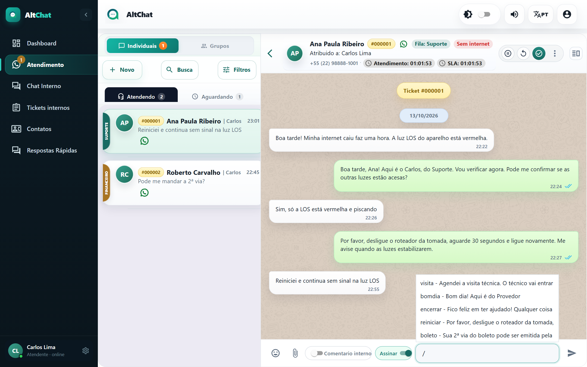
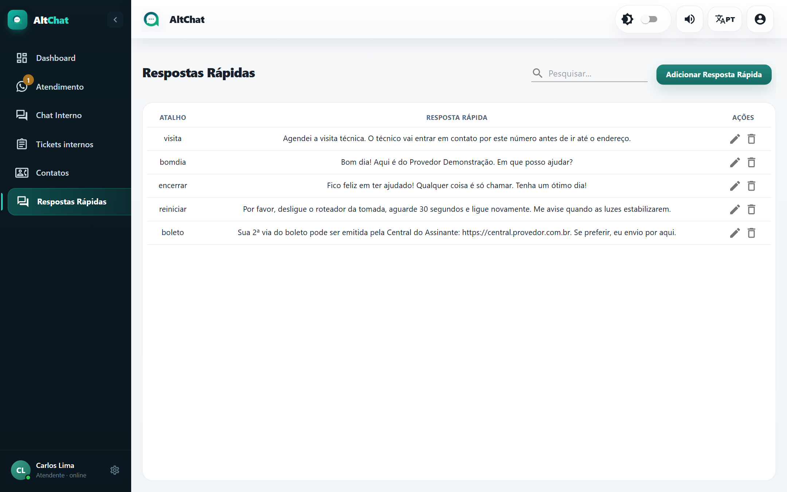
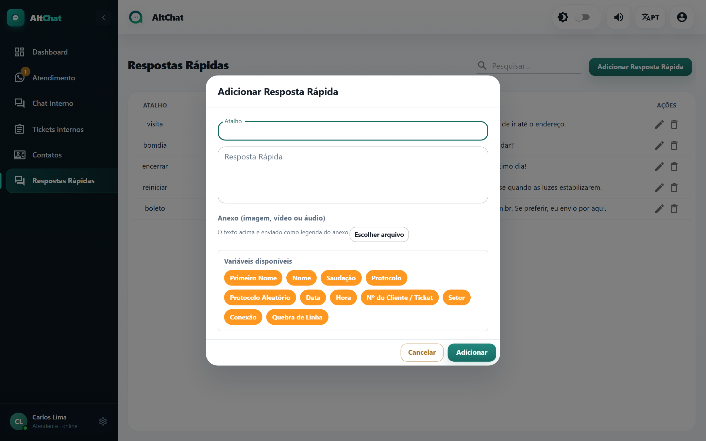

import { Steps, Aside } from '@astrojs/starlight/components';
import Perfil from '../../../components/Perfil.astro';

<Perfil tipo="atendente" />

Respostas rápidas são textos prontos, cada um com um **atalho** curto. Em vez de digitar "Por favor, desligue o roteador da tomada, aguarde 30 segundos..." pela décima vez no dia, você digita `/reiniciar` e pronto. Elas são compartilhadas por toda a empresa.

## Usar uma resposta rápida

<Steps>
1. Na caixa de mensagem, digite `/`. Abre a lista de respostas cadastradas.
2. Continue digitando para filtrar pelo atalho (`/bol` já mostra *boleto*).
3. Clique na resposta ou selecione com as setas e <kbd>Enter</kbd>. O texto entra na caixa, e você ainda pode editar antes de enviar.
</Steps>

Se a resposta tem uma **mídia** anexada (um PDF com a tabela de planos, por exemplo), ela é enviada junto com o texto.

## Criar ou editar

<Steps>
1. No menu lateral, abra **Respostas Rápidas**.

   

2. Clique em **Adicionar Resposta Rápida** (ou no lápis de uma existente).
3. Preencha o **Atalho** (uma palavra, sem espaços, sem acento: é o que você vai digitar depois da barra) e a **Resposta**. Se quiser, anexe um arquivo.
4. Salve.
</Steps>

<Aside type="tip" title="Boas respostas rápidas">
- Comece a resposta com o que o cliente precisa fazer, não com um pedido de desculpas.
- Deixe espaço para personalizar: "Bom dia! Aqui é do Provedor Demonstração" e você completa com o nome do cliente.
- Combine com **Assinar** ligado: a assinatura entra antes do texto automaticamente.
- Padronize os atalhos com a equipe (`boleto`, `reiniciar`, `visita`, `encerrar`). O campo de busca da página ajuda a achar duplicadas.
</Aside>

## Problemas comuns

- **A barra não abre a lista.** A caixa precisa estar vazia ou com a `/` no começo. Apague o que estava escrito e tente de novo.
- **Não acho a resposta que criei.** A lista do `/` filtra pelo **atalho**, não pelo texto. Confira o atalho na página Respostas Rápidas.
