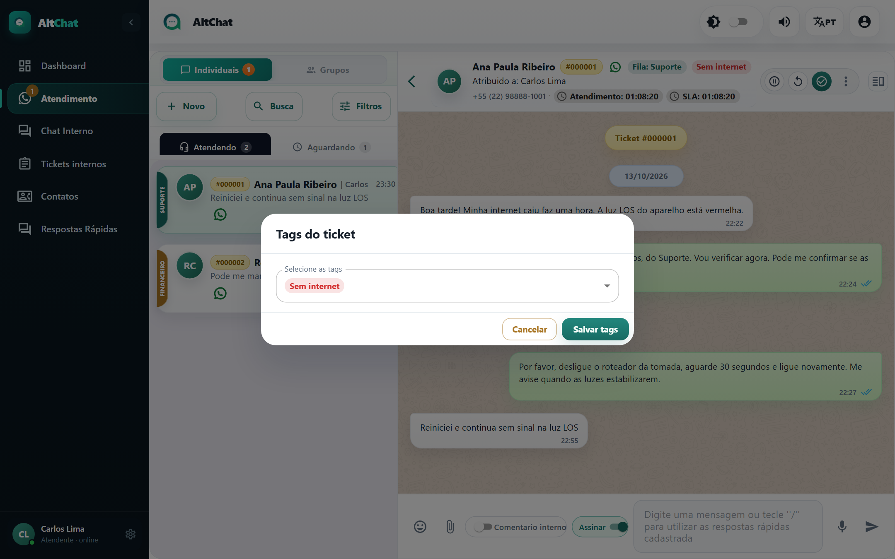
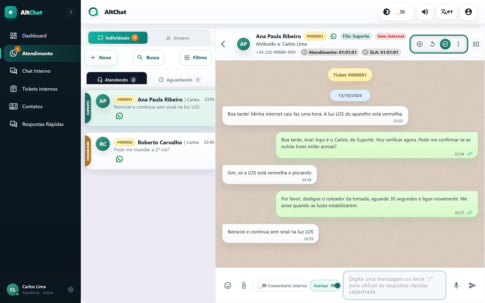

import { Steps, Aside } from '@astrojs/starlight/components';
import Perfil from '../../../components/Perfil.astro';

<Perfil tipo="atendente" />

Duas formas de dizer "sobre o que foi este atendimento":

| | Tag | Assunto |
|---|---|---|
| **O que é** | Etiqueta colorida. Um atendimento pode ter várias. | Motivo do chamado. Um por atendimento. |
| **Quando marcar** | A qualquer momento da conversa. | Ao **Resolver**. |
| **Quem cria a lista** | Administrador, na tela Tags. | Administrador, na tela Assuntos. |
| **Para que serve** | Filtrar a lista, ver na hora de que se trata, relatório "Diagnóstico por etiquetas" do Dashboard. | Relatórios "Motivos por categoria" e "Motivos por fila" do Dashboard. Pode ser obrigatório. |

## Marcar tags

<Steps>
1. Com a conversa aberta, clique em **⋮** no cabeçalho e escolha **Tags**.
2. Marque uma ou mais tags e salve.
</Steps>

As tags aparecem como etiquetas coloridas no cabeçalho do atendimento (como *Sem internet*, na captura abaixo) e podem ser usadas nos [Filtros](/atendentes/abas-e-filtros/).

## Informar o assunto

O assunto é pedido na janela **Resolver chamado**, no campo **Assunto do chamado**. Se a empresa cadastrou assuntos, o campo vira uma lista e pode ser **obrigatório**: sem escolher, o botão de confirmar não libera. Veja [Aceitar, responder e encerrar](/atendentes/aceitar-responder-encerrar/#encerrar-resolver).

<Aside type="tip" title="Categoria no assunto">
O Dashboard agrupa assuntos por **categoria** usando o texto antes do travessão. Um assunto cadastrado como *Suporte — Sem conexão* conta na categoria *Suporte*. Ao escolher, prefira o assunto mais específico da lista.
</Aside>
