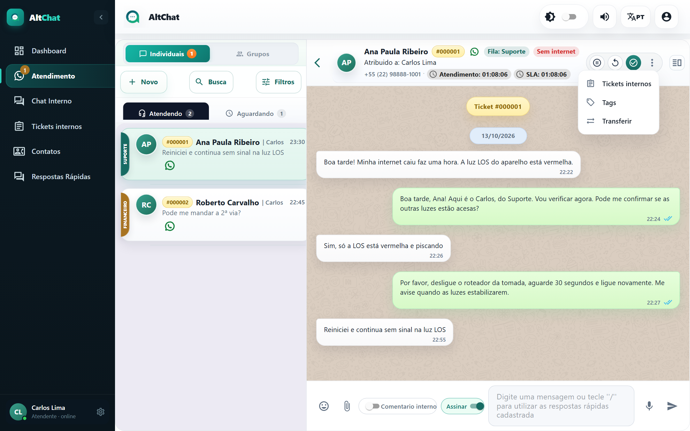
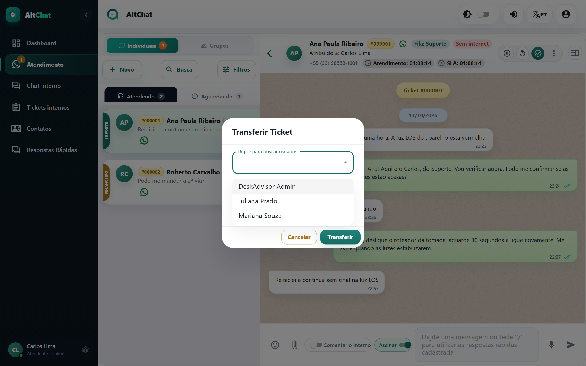

import { Steps, Aside } from '@astrojs/starlight/components';
import Perfil from '../../../components/Perfil.astro';

<Perfil tipo="atendente" />

Transferir manda o atendimento para outra **fila** (o setor certo), para outro **atendente** (uma pessoa específica) ou para os dois. O histórico da conversa vai junto.

## Transferir

<Steps>
1. Com a conversa aberta, clique no botão **⋮** (mais opções) no cabeçalho e escolha **Transferir**.

   

2. Na janela **Transferir Ticket**, escolha a fila em **Transferir para fila** e, se quiser entregar a alguém em particular, digite o nome em **Digite para buscar usuários**. Se deixar o atendente em branco, a conversa cai como *Aguardando* na fila escolhida.

   

3. Deixe **Conexão do chamado** como está. Só administradores conseguem trocar, e só faz sentido quando o cliente precisa passar a ser atendido por outro número.
4. Clique em **Transferir**.
</Steps>

## O que acontece depois

- A conversa sai da sua lista. Se você transferiu para uma pessoa, ela aparece na aba Atendendo dessa pessoa. Se transferiu só para uma fila, aparece em Aguardando para todos da fila.
- Se o administrador ligou as **mensagens automáticas de transferência**, o cliente recebe um aviso (por exemplo, "Você foi transferido para o Financeiro"). Pode haver textos diferentes para transferência para fila e para atendente.
- A transferência fica registrada na **Auditoria** da empresa, com quem fez e para onde.

<Aside type="note" title="Transferir ou Retornar?">
**Retornar** (botão ↺ do cabeçalho) devolve a conversa para a *mesma* fila, sem responsável. **Transferir** muda a fila ou a pessoa. Use Retornar quando pegou por engano; Transferir quando o assunto é de outro setor.
</Aside>

## Problemas comuns

- **A fila que eu quero não aparece.** A lista mostra as filas da **conexão** do atendimento. Se o setor não atende por esse número, peça ao administrador para vincular a fila à conexão (tela Conexões) ou para transferir a conexão.
- **O cliente não recebeu o aviso de transferência.** As mensagens automáticas são opcionais e configuradas pelo administrador em **Configurações → Mensagens de atendimento**.
- **Transferi e o chatbot continuou respondendo.** Quando a conversa está com um bot (n8n ou Typebot), ele só para ao sair da fila dele. Transfira para outra fila, não só para outra pessoa.
