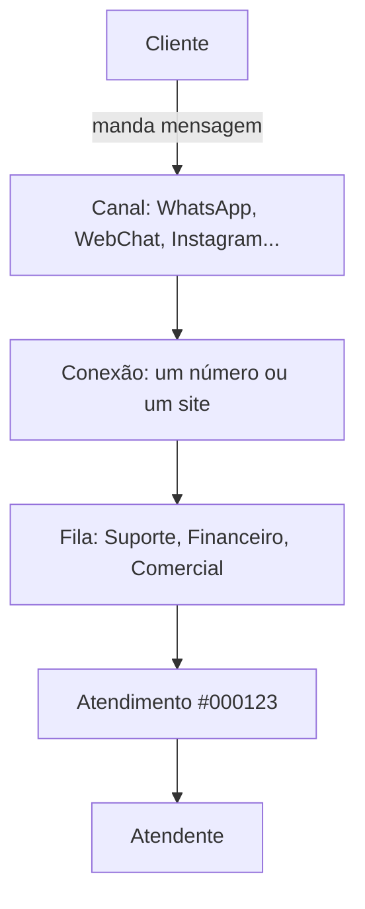
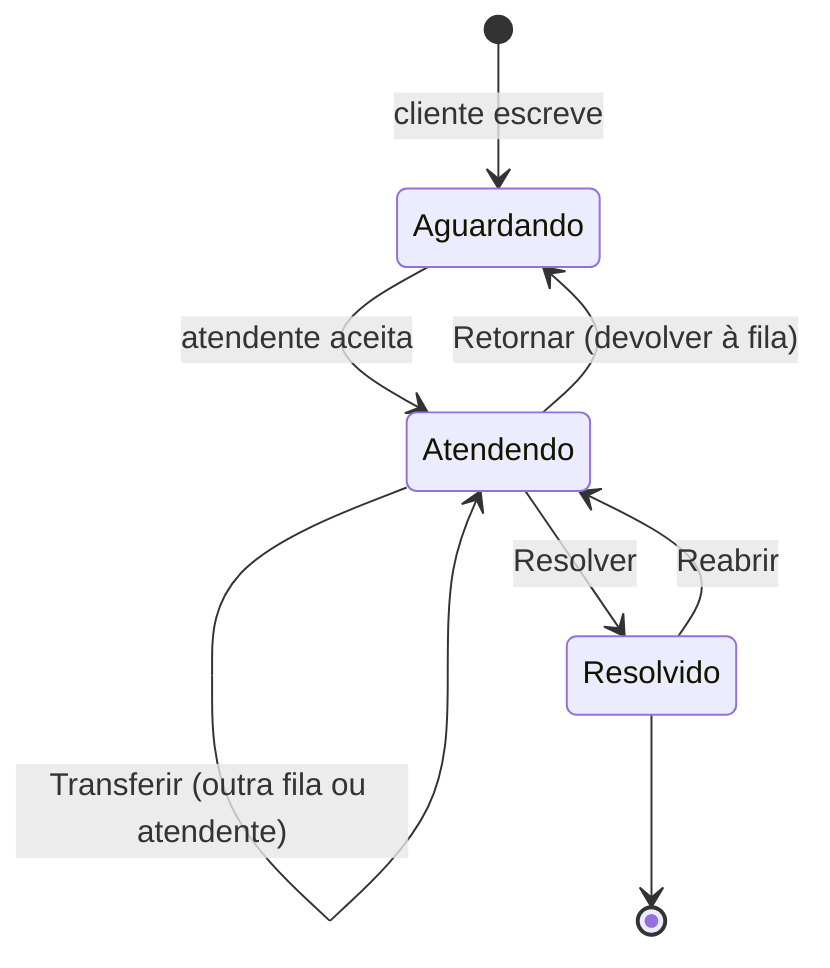

import { Aside, Card, CardGrid } from '@astrojs/starlight/components';

O Altchat é a plataforma de atendimento do seu provedor. Ele reúne as conversas de **WhatsApp**, **WebChat do site e do app**, **Instagram** e **Messenger** em uma única tela, distribui cada conversa para a equipe certa e registra tudo o que aconteceu.

Esta página explica as cinco peças que aparecem em todas as outras. Vale a leitura antes de qualquer guia.

## As cinco peças

### 1. Canal
É o meio pelo qual o cliente fala com você: WhatsApp, WebChat, Instagram Direct ou Facebook Messenger. Cada canal tem regras próprias. O WhatsApp pela API oficial, por exemplo, limita o que pode ser enviado fora da janela de 24 horas.

### 2. Conexão
É uma instância concreta de um canal: *o* número (22) 99999-0001 no WhatsApp, *o* widget instalado no site do provedor. Uma empresa pode ter várias conexões, cada uma atendendo filas diferentes. Quem administra as conexões é o administrador, na tela **Conexões**.

### 3. Fila
É o setor que vai atender: Suporte, Financeiro, Comercial. Quando o cliente escreve, o Altchat pergunta em qual fila ele quer cair (ou decide sozinho, se a conexão tiver fila padrão). Cada atendente pertence a uma ou mais filas e só vê as conversas delas.

### 4. Atendimento (ticket)
É uma conversa com começo, meio e fim, identificada por um número como **#000123**. Ele nasce quando o cliente escreve, fica **Aguardando** até alguém aceitar, passa a **Atendendo** e termina quando o atendente clica em **Resolver**. Se o mesmo cliente escrever de novo depois disso, nasce um atendimento novo.

<Aside type="tip" title="Ticket, chamado ou atendimento?">
São a mesma coisa. A interface usa os três nomes em lugares diferentes. Neste manual preferimos **atendimento**, e usamos **ticket** quando a tela usa.
</Aside>

### 5. Atendente
É você. Cada pessoa da equipe tem um usuário com um perfil (atendente, administrador ou operação central) e um conjunto de filas. O que cada perfil pode fazer está em [Perfis e permissões](/comece-aqui/perfis-e-permissoes/).

## O ciclo de vida de um atendimento

| Estado | Onde aparece | O que significa |
|---|---|---|
| **Aguardando** | aba *Aguardando* | O cliente escreveu e ninguém aceitou ainda. Está na fila. |
| **Atendendo** | aba *Atendendo* | Um atendente aceitou e é o responsável. |
| **Resolvido** | *Busca* e *Filtros* com status *Resolvidos* | Encerrado. Pode ser reaberto. |

## O que mais existe

<CardGrid>
	<Card title="Respostas rápidas" icon="rocket">
		Textos prontos que você chama digitando `/` na caixa de mensagem.
	</Card>
	<Card title="Tags e assuntos" icon="list-format">
		Etiquetas e motivos que classificam o atendimento e alimentam os relatórios.
	</Card>
	<Card title="Chat interno e tickets internos" icon="comment-alt">
		Conversa entre colegas e tarefas internas, separadas da conversa com o cliente.
	</Card>
	<Card title="Dashboard" icon="bars">
		Números do dia: em atendimento, aguardando, tempos médios, filas mais pressionadas.
	</Card>
</CardGrid>

## Próximos passos

- [Perfis e permissões](/comece-aqui/perfis-e-permissoes/): descubra o que o seu usuário pode fazer.
- [Primeiro acesso](/comece-aqui/primeiro-acesso/): entre, ajuste idioma e sons.
- [Aceitar, responder e encerrar um atendimento](/atendentes/aceitar-responder-encerrar/): o guia essencial do atendente.
