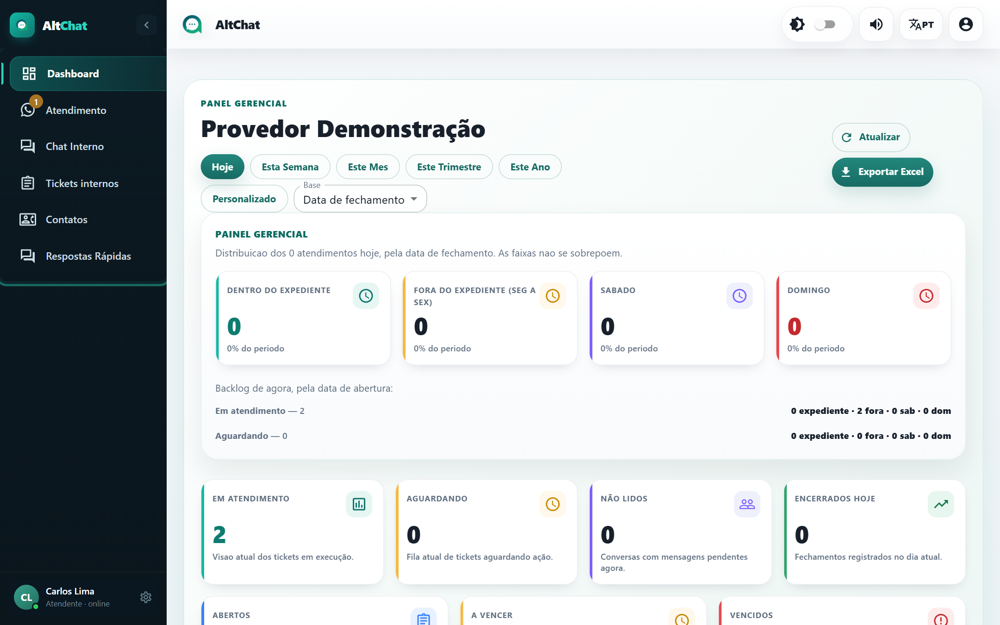
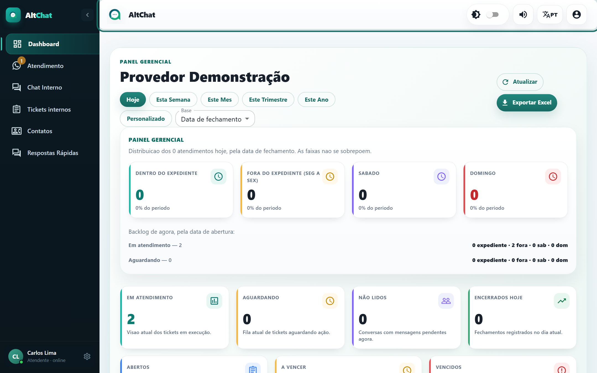

import { Steps, Aside } from '@astrojs/starlight/components';
import Perfil from '../../../components/Perfil.astro';

<Perfil tipo="atendente" /> <Perfil tipo="admin" />

## Entrar

<Steps>
1. Abra **https://app.altchat.com.br** no navegador. Use Chrome, Edge ou Firefox atualizados. O Altchat também funciona no celular, mas a tela de atendimento foi desenhada para o computador.
2. Digite o **e-mail** e a **senha** que o administrador da sua empresa cadastrou. O ícone de olho mostra a senha enquanto você digita.
3. Clique em **Entrar**. Você cai no **Dashboard**.
</Steps>

<Aside type="caution" title="Não tem usuário?">
Quem cria usuários é o administrador da sua empresa, na tela **Usuários**. O link "Cadastre-se" na tela de login cria uma **empresa nova**, não um usuário dentro da sua. Não use.
</Aside>

## A tela

**Menu lateral (esquerda).** Lista as telas do seu perfil. O item **Atendimento** mostra um contador: o total de conversas com mensagem não lida somado às que estão aguardando atendimento. A seta no topo recolhe o menu; recolhido, ele mostra só os ícones.

**Seu usuário (canto inferior).** Nome, perfil e estado. A bolinha verde indica **online**; depois de alguns minutos sem mexer no sistema você passa a **ausente** automaticamente (o tempo é definido pelo administrador). Clique na engrenagem para editar seu cadastro.

**Barra superior (direita).** Da esquerda para a direita:

| Controle | O que faz |
|---|---|
| Chave ao lado da lua | Alterna **modo escuro**. |
| Alto-falante | **Silencia** ou reativa os sons de nova mensagem. |
| Ícone de idioma | Troca entre **Português**, **Inglês** e **Espanhol**. |
| Ícone de pessoa | Abre o menu com **Perfil** e **Sair**. |

## Ajustes que valem a pena fazer no primeiro dia

<Steps>
1. **Teste o som.** Deixe os sons ligados pelo menos no começo: cada mensagem nova toca um aviso, mesmo com a aba do navegador em segundo plano.
2. **Permita notificações do navegador.** Na primeira vez o navegador pergunta se o site pode enviar notificações. Aceite, para ver o aviso de mensagem nova mesmo com outra janela aberta.
3. **Confira as suas filas.** No menu Atendimento você só vê as conversas das filas em que o administrador colocou você. Se faltar alguma, peça a ele.
4. **Troque a senha**, se recebeu uma senha provisória: clique no seu nome no canto inferior do menu e edite o cadastro.
</Steps>

## Sair

Clique no ícone de pessoa, na barra superior, e depois em **Sair**. Em computador compartilhado, saia sempre ao fim do turno: enquanto você está logado, os atendimentos continuam atribuídos a você.
